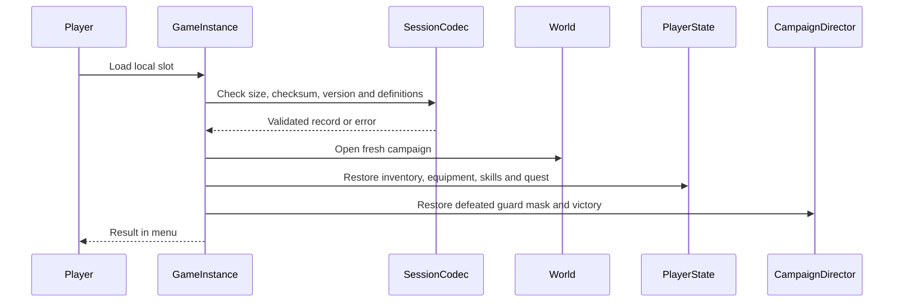

# 시작·접속·저장 흐름

시작 화면에서 혼자 시작, 방 생성, 주소로 접속, 저장 불러오기, 종료를 제공하고, 호스트의 개인 체크포인트와 세계 저장의 플레이어 프로필, 원격 플레이어의 서버 발급 신원을 구현했다. 이 문서는 세션의 현재 계약과 메뉴, 접속 규칙을 소유하고 하위 문서로 안내한다. [StudyRoadmap](StudyRoadmap.md)의 단계 6 사양이다. 게임 중 Esc는 같은 메뉴를 열어 저장, 설정, 시작 화면 복귀를 제공한다. 전투 중에도 월드는 계속 실행되며 메뉴는 해당 플레이어의 입력만 막는다.

## 하위 문서

| 문서 | 읽는 때 |
|---|---|
| [개인 체크포인트](SessionFoundation/Checkpoint.md) | 저장 파일의 범위, 형식, 검증, 변환을 바꿀 때 |
| [플레이어 복원](SessionFoundation/PlayerRestore.md) | 플레이어 프로필, 장비·인벤토리 복원, 다중 플레이어 준비, 원격 신원을 바꿀 때 |
| [세션 검증](SessionFoundation/Verification.md) | 메뉴, 접속, 저장의 실행 결과와 미확인 범위를 볼 때 |

## 현재 계약

| 주제 | 현재 계약 | 정한 절 |
|---|---|---|
| 개인 체크포인트 | 단일 로컬 슬롯 `CCL_Checkpoint`에 호스트 개인 상태와 원정 체크포인트를 저장한다. 외부 세션 형식은 8(`FCCLSessionRecord::Version`)이며 보급품은 배치 ID로 기록한다 | [저장 범위](SessionFoundation/Checkpoint.md#저장-범위), [배치 식별과 체크포인트 검증](SessionFoundation/Checkpoint.md#배치-식별과-체크포인트-검증) |
| 정의 해석 | 저장의 아이템·스킬 이름은 `DA_ItemCatalog`로 해석하고 없는 이름은 거부한다 | [정의 카탈로그와 보급품 개수](SessionFoundation/Checkpoint.md#정의-카탈로그와-보급품-개수) |
| 세계 저장의 플레이어 | 세계 형식 6부터 플레이어 프로필 배열이 있고, 서버가 등록한 PlayerState를 수집·복원한다. 현재 세계 형식은 7이다(`FCCLWorldSnapshotCodec::Validate`) | [세계 플레이어 본문 구현·검증](SessionFoundation/PlayerRestore/Profile.md#세계-플레이어-본문-구현검증), [세계 플레이어 참가자 구현·검증](SessionFoundation/PlayerRestore/Profile.md#세계-플레이어-참가자-구현검증) |
| 원격 플레이어 신원 | 서버가 첫 접속에서 비밀 키를 발급하고 재접속 때 자동으로 프로필에 연결한다. 인증이 아니다([결정 21](decisions/0021-server-issued-player-identity.md)) | [원격 플레이어 신원 연결과 복원 시 접속자 유지](SessionFoundation/PlayerRestore/Identity.md#원격-플레이어-신원-연결과-복원-시-접속자-유지) |
| 복원 중 접속자 | 저장 본문에 프로필이 없는 등록 플레이어는 거부하지 않고 현재 상태로 유지한다 | [원격 플레이어 신원 연결과 복원 시 접속자 유지](SessionFoundation/PlayerRestore/Identity.md#원격-플레이어-신원-연결과-복원-시-접속자-유지) |
| 복원 실패 경계 | 여러 Loadout의 GAS 효과를 모두 준비한 뒤 세계를 확정하고, 어느 쪽이 거부되면 기존 상태를 유지한다 | [다중 플레이어 복원 준비 경계](SessionFoundation/PlayerRestore/Loadout.md#다중-플레이어-복원-준비-경계), [인벤토리·장비 복원 준비와 실행 검증](SessionFoundation/PlayerRestore/Loadout.md#인벤토리장비-복원-준비와-실행-검증) |
| 알림 순서 | 호스트 계정·퀘스트를 확정한 뒤 보관함·플레이어 인벤토리 알림을 보낸다 | [호스트 계정·퀘스트의 알림 전 확정](SessionFoundation/PlayerRestore/Profile.md#호스트-계정퀘스트의-알림-전-확정) |
| 계정 | 조회·Tick·보상은 원장을 바꾸지 않고, 사라진 계좌는 복원 확정의 `EnsureOpen`만 다시 연다 | [계정 조회와 초기 생성 분리 구현·검증](SessionFoundation/PlayerRestore/Identity.md#계정-조회와-초기-생성-분리-구현검증), 원격 신원 절 |

## 책임과 수명

| 구성 | 책임과 수명 |
|---|---|
| GameInstance | 접속 결과·보류한 불러오기와 LocalPlayer별 메뉴 핸들 |
| SessionMenuScreen·문맥 | 버튼·주소 입력·설정·성공과 실패 표시, 공용 UI 관리자의 월드 범위 화면 |
| SessionRecord와 Codec | 버전·무결성·수량·정의 ID 검증, Actor와 UI를 참조하지 않는 값 |
| Inventory·Loadout·Expedition | 검증된 개인 상태 적용, 서버 PlayerState 수명 |
| CampaignDirector | 처치 체크포인트와 남은 적 재구성, 서버 월드 수명 |

시작·일시정지 메뉴는 `UCCLSessionMenuScreen`에서 기존 Slate 본문을 표시한다. 포커스와 입력 모드는 CommonUI가 적용하며 GameInstance가 별도로 `SetInputMode`를 호출하지 않는다. 게임 중 뒤로 가기는 해당 플레이어의 메뉴를 닫고, 시작 화면에서는 메뉴를 유지한다. 메뉴를 여는 플레이어만 인벤토리·대화창을 닫는다. 맵 이동 전에는 모든 로컬 메뉴를 닫는다. 구현과 이전 검사 근거는 [UIFoundation](UIFoundation.md)을 따른다.

## 접속과 설정

주소 입력은 호스트 이름 또는 IPv4와 선택적인 포트만 허용한다. URL 옵션·경로·공백·범위를 벗어난 포트는 거부한다. LAN 또는 직접 접속이 가능한 호스트 주소를 쓰며 매치메이킹·계정·NAT 중계는 이번 범위가 아니다. 접속·이동 실패는 엔진 이벤트를 받아 메뉴에 표시한다.

설정은 엔진 GameUserSettings의 화면 품질과 창 모드를 사용한다. 입력은 메뉴 버튼으로 적용하고 저장하며 다음 실행에도 유지한다. 원격 서버나 다른 플레이어의 설정을 바꾸지 않는다.
