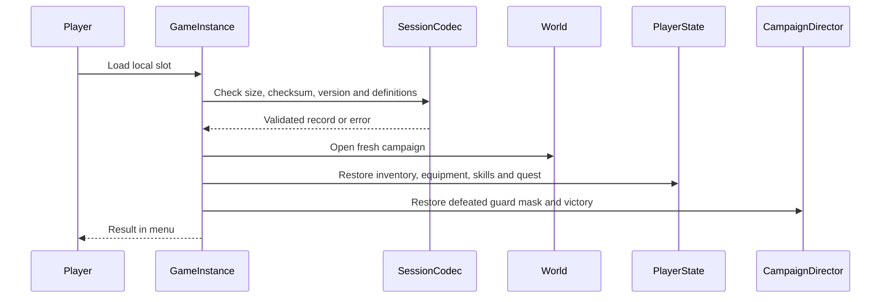
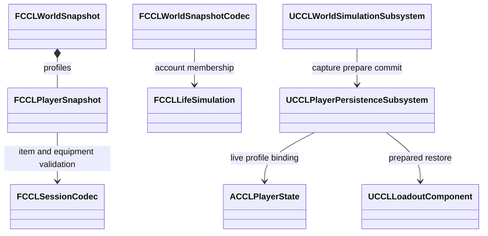

# 시작·접속·저장 흐름

단계 6은 시작 화면에서 혼자 시작, 방 생성, 주소로 접속, 저장 불러오기와 종료를 제공한다. 게임 중 Esc는 같은 메뉴를 열어 저장·설정·시작 화면 복귀를 제공한다. 전투 중에도 월드는 계속 실행되며 메뉴는 해당 플레이어의 입력만 막는다.

## 책임과 수명

| 구성 | 책임과 수명 |
|---|---|
| GameInstance | 접속 결과·보류한 불러오기와 LocalPlayer별 메뉴 핸들 |
| SessionMenuScreen·문맥 | 버튼·주소 입력·설정·성공과 실패 표시, 공용 UI 관리자의 월드 범위 화면 |
| SessionRecord와 Codec | 버전·무결성·수량·정의 ID 검증, Actor와 UI를 참조하지 않는 값 |
| Inventory·Loadout·Expedition | 검증된 개인 상태 적용, 서버 PlayerState 수명 |
| CampaignDirector | 처치 체크포인트와 남은 적 재구성, 서버 월드 수명 |

시작·일시정지 메뉴는 `UCCLSessionMenuScreen`에서 기존 Slate 본문을 표시한다. 포커스와 입력 모드는 CommonUI가 적용하며 GameInstance가 별도로 `SetInputMode`를 호출하지 않는다. 게임 중 뒤로 가기는 해당 플레이어의 메뉴를 닫고, 시작 화면에서는 메뉴를 유지한다. 메뉴를 여는 플레이어만 인벤토리·대화창을 닫는다. 맵 이동 전에는 모든 로컬 메뉴를 닫는다. 구현과 이전 검사 근거는 [UIFoundation](UIFoundation.md)을 따른다.



## 이번 저장 정책

단일 로컬 슬롯에 호스트의 인벤토리 GUID·정의 ID·수량, 장비, 학습 스킬, 포인트, 금화·퀘스트와 원정 체크포인트를 저장한다. 접속한 손님의 개인 상태는 이번 파일에 포함하지 않는다. 손님은 호스트의 파일 저장·불러오기를 요청할 수 없다. 최종 계정·협동 보상 소유권을 확정하는 정책은 아니다.

체크포인트는 처치한 경비병, 보스 격파 여부와 남은 마을 보급품이다. 호스트는 마을에서 완전한 체력으로 시작한다. Agent 스냅샷이 있는 저장은 생활 NPC와 전투 적의 부상을 복원한다. 살아 있던 전투 적은 체크포인트 위치에 재생성하며 공격 타이머는 다시 계산한다. Agent 스냅샷이 없는 이전 저장은 적의 기본 체력을 사용한다. 사망·행동 중에는 저장을 거부한다. 정확한 적 위치·공격 타이머를 직렬화하는 방식보다 재시작 상태의 일관성을 우선한 초안이다.

파일은 엔진의 플랫폼 저장 슬롯 API로 기록하되 UObject 클래스 경로를 역직렬화하지 않는다. 제한된 크기의 JSON 값 앞에 형식 식별자와 CRC를 붙인다. CRC는 우발적인 손상 감지용이며 변조 방지 장치가 아니다. 필수 필드·버전·알려진 정의 ID·수량·GUID 중복·장비 참조·스킬과 체크포인트 조합을 검증한 뒤 새 월드에 적용한다. 실패한 파일은 자동으로 덮어쓰지 않는다.

현재 저장 버전은 7이다. 버전 6부터 공통 세계 시계·환경·생활을 함께 저장하며, 버전 7에는 선택적인 음식 묶음 이력을 추가했다. 음식은 세계 ID·완료 시각·수량을 함께 검증하고 형식 1-6의 누락 상태는 빈 그대로 읽는다. 구현·검증 범위는 [음식 상태·인벤토리·세션 검증](EnvironmentEcology.md#음식-상태인벤토리세션-검증)을 따른다.

세계 저장의 등록 보관함과 호스트 개인 항목은 서로 다른 저장 소유자다. `SaveSession`은 같은 호출에서 개인 항목을 수집하고 해당 인벤토리만 세계 수집에서 제외한다. 다른 미등록 음식은 거부하며, 개인 항목과 세계 보관함의 아이템 GUID 중복도 거부한다. 불러오기는 개인 장비 효과를 먼저 준비한 뒤 세계를 복원하고 개인 인벤토리·장비·진행을 확정한다. 이는 새 맵에서의 세션 재개 순서이며 현재 월드의 개인 프로필 전체를 원자적으로 되돌리는 계약은 아니다. 일반 세계 저장·맵 전환의 개인 음식 연결은 남아 있다. 검증은 [컨테이너 세계 저장 검증](EnvironmentEcology.md#컨테이너-세계-저장-검증)을 따른다.

버전 5부터 아이템 GUID별 `LoadedAmmo`를 기록하며 형식 1-4는 탄창을 비운 상태로 변환한다. 탄약 값은 해당 무기의 탄창 용량을 넘을 수 없다. 부위는 `Equipment.Slot.*` 문자열로 기록한다. 형식 3의 enum 이름 또는 숫자는 구체적인 슬롯 태그로 변환하고, 알 수 없는 태그·상위 태그·다른 범주의 태그는 거부한다. 형식 1-3 변환과 형식 4 왕복 자동 검사, 별도 프로세스 저장·복원을 통과했다. 검사 근거는 [ProgressionFoundation](ProgressionFoundation.md)의 태그 개편 검사 표를 따른다.

각 항목에 가방 슬롯을 기록하고 장착 항목은 `INDEX_NONE`으로 표시한다. 부위별 장착 목록은 GUID를 참조하며 양손 장비는 같은 GUID로 두 손을 모두 차지해야 한다. 형식 1은 배열 순서로 가방 칸을 만들고, 형식 1·2의 단일 장비 참조는 새 부위 목록으로 변환한다. 중복 부위·잘못된 장비 종류·불완전한 양손 점유·어느 부위에도 연결되지 않은 장착 항목은 거부한다. 구현 근거는 `Source/CCL/Session/CCLSessionRecord.cpp`다.

태그 변경 전 형식 3에서는 2026-10-07 별도 프로세스로 가방 칸·장착 상태·GUID·수량·효과를 저장·복원했고 양손 장비 직렬화와 불완전한 점유 거부도 통과했다. 근거는 `Saved/StageValidation/Equipment-Session.log`와 `Saved/Tests/UIVisual/1280x720-20261007-170902/game.log`다.

주소 입력은 호스트 이름 또는 IPv4와 선택적인 포트만 허용한다. URL 옵션·경로·공백·범위를 벗어난 포트는 거부한다. LAN 또는 직접 접속이 가능한 호스트 주소를 쓰며 매치메이킹·계정·NAT 중계는 이번 범위가 아니다. 접속·이동 실패는 엔진 이벤트를 받아 메뉴에 표시한다.

설정은 엔진 GameUserSettings의 화면 품질과 창 모드를 사용한다. 입력은 메뉴 버튼으로 적용하고 저장하며 다음 실행에도 유지한다. 원격 서버나 다른 플레이어의 설정을 바꾸지 않는다.

## 기존 구현 검증 결과

2026-10-07 UE 5.9에서 프로젝트 생성 BAT·CCLEditor 빌드·시작 맵 저장을 통과했다. 서로 다른 프로세스의 저장·불러오기에서 GUID·수량·장비·두 스킬·체력·금화·퀘스트와 부분 처치 상태를 확인했다. 이미 수집한 보급품은 복원하지 않았다. 메뉴 복귀 후 재불러오기, 남은 경비병 처치로 보스 진입, 승리 저장·복원 후 적이 없는 상태도 통과했다.

잘못된 주소, 손상된 실제 검증 슬롯, 모르는 버전·정의, 음수 수량, 중복 GUID와 없는 장비 참조를 거부했다. 화면 품질 변경과 설정 파일 재읽기로 저장을 확인했다. 별도 호스트·클라이언트가 메뉴의 접속 경로로 연결됐고 손님의 호스트 저장 요청은 거부됐다. 존재하지 않는 포트의 접속 실패도 메뉴에 표시됐다.

실제 Slate 첫 버튼에 Enter 입력을 보내 새 원정을 시작했다. 전체 버튼의 수동 마우스 조작과 화면 모드 전환은 미확인이다. 화면 검토에서 글자 크기·문구 잘림·키보드 포커스를 수정한 뒤 최종 렌더링과 저장 검사를 다시 통과했다. 시작·불러온 인벤토리·게임 중 메뉴 화면을 확인했다. 콘텐츠 Standalone, 성장 Dedicated, 전투 Listen 회귀도 통과했다. 패키징 실행은 단계 7에서 별도로 검사한다.

| 검사 | 로컬 근거 |
|---|---|
| 생성·빌드·시작 맵 | `Saved/StageValidation/Stage6-Generate.log`, `Stage6-Build.log`, `Stage6-Assets.log` |
| 최종 저장·불러오기·키보드·화면 | `Stage6-Rendered-Final.log`, `Saved/Tests/SessionSmoke/`의 최종 실행 원본 로그 |
| 방 생성·접속, 접속 실패 | `Stage6-Network.log`, `Stage6-Failure.log` |
| 콘텐츠·성장·전투 회귀 | `Stage6-Content.log`, `Stage6-Progression.log`, `Stage6-Combat.log` |
| 화면 | `Saved/Tests/SessionVisual/` |

표에서 파일명만 쓴 로그는 `Saved/StageValidation/` 기준이다. 테스트는 `CCL_Validation` 슬롯을 쓰며 일반 플레이의 `CCL_Checkpoint` 슬롯과 구분한다. 로컬 저장 파일은 Git에 넣지 않는다. 엔진 API 근거는 `<Engine>/Source/Runtime/Engine/Private/GameplayStatics.cpp:2215`의 `SaveDataToSlot`과 같은 파일 2316행의 `LoadDataFromSlot` 경로와 `Engine.h:2390`의 `OnNetworkFailure` 이벤트다.


Agent 생활 저장 통합은 결정 18과 [AgentFoundation](AgentFoundation.md)을 따른다. v5에는 선택적 `AgentSimulation` 스냅샷과 `AccountId`가 추가된다. 계정이 포함된 저장의 이전 `Coins` 필드는 0이며, 옛 저장에만 금화 이관 값으로 쓰인다. 생활 스냅샷은 Unreal 구조체 기반 로컬 저장이므로 JSON의 Definition 허용 목록과 별개로 Feature 타입·버전·교차 참조를 검증한다. 신뢰할 수 없는 외부 저장 파일을 안전하게 읽는 보안 경계로 사용하지 않는다.


## 공통 세계의 플레이어 프로필 설계

현재 세계 형식은 6이며 서버가 등록한 PlayerState의 수집·복원과 연결 해제 기록 보존까지 구현했다. 일반 접속·재접속에서 식별 키를 자동으로 연결하는 작업은 남아 있다. 목표는 일반 세계 저장·복원과 맵 전환에서도 플레이어가 회수한 음식, 장비·스킬·포인트·퀘스트와 계정 연결을 같은 세대에 포함하는 것이다. 개인 프로필은 서버가 정한 식별 키와 계정 ID를 가진다. 계정 잔액은 LifeSimulation의 경제 원장에만 저장하며 프로필에는 중복하지 않는다. 인벤토리·바닥 픽업·다른 플레이어 사이의 아이템 GUID 중복도 세계 저장 검증에서 거부한다.

세계 형식 6은 플레이어 프로필 배열을 가진다. 항목은 기존 개인 세션의 정의 ID·음식 표현과 장비 점유 검증을 재사용하고, 중첩 세계 스냅샷을 프로필에 넣지 않는다. 형식 1-5는 프로필이 없는 저장으로 명시적으로 변환한다. 빈 프로필 배열을 읽었다는 이유로 현재 플레이어의 음식과 계정 연결을 조용히 누락하는 방식은 사용하지 않는다.

`FCCLPlayerSnapshot`은 식별 키·계정 ID·항목·장비 슬롯·스킬·포인트·퀘스트·체력과 스태미나 비율을 소유한다. 가방 용량과 음식 보관 조건도 프로필이 소유한다. 프로필 본문은 최대 64명·전체 4,096개 항목·8MiB로 제한하고, 식별 키는 최대 192자의 정규화된 소문자 ASCII로 저장한다. 이는 직렬화 예산이며 동시 접속 성능 보장 수치는 아니다. 기존 JSON 세션을 그대로 중첩하면 세계 저장이 재귀적으로 들어갈 수 있으므로 제한된 값만 가진 별도 이진 본문을 사용한다. 값 검증기는 Actor를 생성하지 않고 개수·길이·음식 시각·장비 참조·계정 존재·중복 GUID를 확인한다. 런타임 참여자는 복원 전에 실제 항목·정의·장비 효과와 연결할 PlayerState를 준비하고 모든 인벤토리 알림을 보류한다. 값 검사 이후에도 GAS가 실제 적용을 거부할 수 있으므로 준비 단계는 그 실패와 새 효과의 취소까지 포함해야 한다. 공통 모델이 성공한 뒤 준비된 개인 배열·계정 연결·장비 효과·능력치를 확정하고 마지막에 알림을 보낸다.



장비 복원에서 기존 효과를 먼저 제거한 뒤 `Equip`을 반복 호출하면 나중 항목의 오류가 앞의 장비·스킬을 일부 적용한 채 남길 수 있다. 준비 단계에서 전체 장착 점유와 정의·스킬 효과를 검사하고, 확정 단계에서는 장비를 하나씩 교환하는 UI 경로를 사용하지 않는다. 이 구조는 준비 자료와 상태 보류 비용이 늘지만 세계·개인 상태의 실패 경계를 대조할 수 있다. GAS 이벤트의 임의 재진입이나 외부 플러그인 효과의 무조건 성공을 보장하는 계약은 별도로 다뤄야 한다.

검증은 형식 왕복·이전 저장 변환, 중복 계정·항목·식별 키와 없는 장비·부분 양손 점유의 거부, 실제 음식 회수 후 세계 저장, 다중 플레이어의 장비·부상·금화·퀘스트 복원, 실패 원본 보존, 맵 전환·새 프로세스 재개와 소유자 전용 복제를 대상으로 한다. 원격 플레이어의 자동 재연결은 서버가 신뢰하는 신원과 연결해야 하며 클라이언트가 임의 계정 ID를 제출하는 방식으로 구현하지 않는다. 호스트 개인 슬롯의 기존 완전 체력 재개 정책과 일반 세계의 상태 복원 정책을 구분한다.


## 인벤토리·장비 복원 준비와 실행 검증

`UCCLLoadoutComponent::RestoreState`는 인벤토리 항목·장착 점유·스킬·포인트를 함께 검사하고 적용한다. 장착 항목은 가방 슬롯 밖에 있어야 하며 양손 장비는 양쪽 참조를 모두 가져야 한다. 누락된 아이템·중복 부위·고립된 장착 항목·잘못된 스킬·포인트는 상태 변경 전에 거부한다. 후보를 먼저 복사하므로 호출자가 현재 인벤토리·장비 배열 자체를 넘겨도 복원 중 배열을 잃지 않는다.

복원 대상 효과는 비주기·비중첩 Infinite 효과의 수치 가산 Modifier로 제한한다. 현재 체력·스태미나를 직접 수정하는 Modifier, Execution·GameplayEffect Component·Cue와 Attribute 기반·커스텀 계산은 거부한다. 정적 수치 또는 SetByCaller로 계산한 결과와 대상 AttributeSet도 검사한다. 기존 장착 기능이 허용하는 모든 효과가 이 복원 계약에 포함되지는 않는다. 조건부 효과를 추가할 때는 그 효과의 가역적인 준비·취소 계약도 구현해야 한다.

서버는 새 효과를 모두 적용한 뒤 기존 효과를 제거한다. 도중 GAS가 적용을 거부하면 새 핸들만 제거하고 기존 효과 핸들·개인 항목·포인트·부상을 유지한다. `FScopedAggregatorOnDirtyBatch`로 Attribute 계산 알림을 묶고 인벤토리 알림은 항목·장착 목록·스킬·포인트와 아바타 동기화 뒤 한 번 게시한다. 복원 성공 시 이전 무기 행동 부여도 정리해 같은 GUID가 과거 정의를 계속 참조하지 않게 한다. 다음 무기 조작에서 복원된 정의로 능력을 부여한다.

`bResetHealth=false`는 부상을 유지하며 최종 최대 체력이 낮아지면 그 값으로 제한한다. 기존 개인 체크포인트는 기본값 `true`로 완전 체력을 유지한다. `UCCLGameInstance::ApplyRecord`도 세계 적용 전에 개인 후보와 실제 GAS 효과 적용을 준비하고 인벤토리·장비는 이 통합 경로로 적용한다. 구현은 `Source/CCL/Items/CCLLoadoutRestore.cpp`와 `Source/CCL/Session/CCLGameInstance.cpp`에 있다.

이 계약은 임의 GAS 적용 델리게이트의 외부 부작용을 되돌리는 트랜잭션은 아니다. Attribute 알림 묶음이 효과 적용 델리게이트 자체를 지연하지 않으며, 인벤토리의 기존 트랜잭션도 모든 외부 변경을 차단하는 잠금은 아니다. 복원 중 같은 Loadout의 조작·복원 재진입은 거부하지만 외부 코드가 다른 상태를 수정하는 경우까지 보장하지 않는다. 다중 Loadout의 준비 경계와 개인 세션 연결은 아래 절을 따른다. 등록된 세계 프로필의 계정·퀘스트 확정은 아래 참가자가 처리한다. 모든 접속자의 자동 등록과 신원 연결은 아직 구현하지 않았다. 호스트 계정·퀘스트의 확정은 [알림 전 확정](#호스트-계정퀘스트의-알림-전-확정)을 따른다. 캠페인 체크포인트 후처리는 별도 경로이므로 이 결과를 전체 세션의 원자 복원으로 확대하지 않는다.

UE 5.8.3 소스에서 `AbilitySystemComponent.cpp:1037`의 적용 Query 거부와 2160줄의 효과 적용 델리게이트 호출을 확인했다. 경로 기준은 `<Engine>/Plugins/Runtime/GameplayAbilities/Source/GameplayAbilities/Private/`다. Attribute 알림 보류 계약은 같은 모듈의 `Public/GameplayEffectAggregator.h:392`에 있다. 이 확인만으로 해당 기능이 UE5에서 처음 도입됐다고 주장하지 않는다.

| 검사 | 결과와 로컬 근거 |
|---|---|
| 최종 프로젝트 생성·Editor 빌드 | 성공. `Saved/EnvironmentStages/LoadoutRestore-FinalGPF.log`, `LoadoutRestore-FinalBuild.log` |
| 실제 PlayerState·GAS 복원 | 실패 원본·효과 핸들 보존, 가득 찬 가방에서 양손 장비 교체, 중복 보너스 방지, 부상·완전 체력 정책, 이전 무기 부여 제거 통과. `Saved/Tests/LoadoutRestore/20261010-212916-155/game.log` |
| 별도 프로세스의 개인 세션 재개 | 음식 이력·장비·스킬·부분 체크포인트, 메뉴 왕복·승리 재개 통과. `Saved/Tests/SessionSmoke/20261010-212913` |
| CCL 자동 검사 | 140/140, 경고·실패·미실행 0. `Saved/Tests/Automation/20261010-212917-604/report/index.json` |

실행기는 `Tools/Validation/run_loadout_restore.ps1`이며 EnvironmentScenario의 Standalone에서 확인했다. 네트워크의 전체 개인 프로필 복원, 실제 플레이어가 회수한 음식의 일반 세계 저장과 맵 전환, 신뢰한 계정 신원의 재연결은 후속 통합 검증이다.


## 세계 플레이어 본문 구현·검증

`FCCLPlayerSnapshot`과 `CCLPlayerSnapshot`은 플레이어 값 본문의 형식·길이·개수·상태 검증을 맡는다. 본문 버전은 1이며 세계 형식 6의 CRC 범위에 포함된다. 인벤토리·장비 검증은 `FCCLSessionCodec::ValidateProfile`과 공유한다. 이 경로는 중첩 세계·별도 금화·호스트 체크포인트를 받지 않으므로 개인 세션 검증이 세계 검증으로 재귀 호출되는 일을 막는다. 실험장에서 회수하는 `DA_FoodSample`도 명시적인 정의 ID로 해석한다.

세계 검증은 플레이어 간 식별 키·계정·아이템 중복과 플레이어·세계 보관함 사이의 아이템 중복을 거부한다. 계정은 같은 Life 원장에 존재해야 하고 음식의 세계 ID·완료 시각·수량·동적 보관 조건이 맞아야 한다. 개인 세션의 바깥 항목·계정과 중첩 세계 안의 플레이어 프로필도 소유권을 중복할 수 없다. 세계 형식 1-5는 빈 프로필 배열과 `bPlayersMigrated` 표시로 읽으며 프로필이나 계정을 만들어 넣지 않는다.

`UCCLWorldSimulationSubsystem::Save`는 등록된 플레이어를 이 배열에 수집한다. `Start`는 프로필 기록을 유지하고 `Restore`는 현재 등록된 PlayerState와 함께 복원한다. 구현·실행 범위는 [세계 플레이어 참가자](#세계-플레이어-참가자-구현검증)를 따른다. 등록되지 않은 플레이어의 음식은 저장에서 누락하지 않고 거부한다. 일반 접속의 자동 등록, 맵 전환·재접속의 신원 연결은 아직 완료되지 않았다.

| 검사 | 결과와 로컬 근거 |
|---|---|
| 최종 프로젝트 생성·Editor 빌드 | 성공. `Saved/EnvironmentStages/PlayerProfile-FinalGPF.log`, `PlayerProfile-FinalBuild.log` |
| 프로필·세계 값 검증과 기존 자동 검사 | 143/143, 경고·실패·미실행 0. `Saved/Tests/Automation/20261010-214223-820/report/index.json` |
| 개인 음식·장비의 별도 프로세스 재개 | 기존 세션 형식 7의 호스트 저장·읽기 통과. `Saved/Tests/SessionSmoke/20261010-214222` |
| 세계·지형 맵 네 번 왕복 | Standalone 통과. `Saved/Tests/TerrainTravel/Standalone-20261010-214437-716` |
| 바닥 음식 픽업의 저장·복원·새 프로세스 재개 | Standalone 통과. `Saved/Tests/FoodPickup/Standalone-20261010-214438-812` |

새 자동 검사는 프로필·양손 점유·음식·부상 비율·계정 잔액의 왕복, 불완전한 점유·잘못된 참조·음식 시각·수량·중복 소유권의 거부와 실패 출력 보존을 확인했다. 정상 프로필 64명과 65명, 정상 항목 총 4,096개와 4,097개를 각각 대조했다. 잘못된 UTF-8·큰 길이·큰 배열 수·잘림·뒷부분 추가도 거부했다. 저장을 읽는 보안·인증 경계 전체를 검증한 결과는 아니며 식별 키 형식 검사도 계정 인증을 대신하지 않는다.

첫 맵 왕복 검사는 현재 상태를 비교하는 후보가 보관함을 수집하지 않아 실패했다. `CCLTerrainTravelSmokeSubsystem`이 실제 `UCCLInventoryPersistenceSubsystem::Capture` 결과를 비교 후보에 넣도록 보완한 뒤 통과했다. 저장된 값을 비교 후보에 복사하지 않는다. 원본 실패 로그는 `Saved/Tests/TerrainTravel/Standalone-20261010-214223-530/server.log`에 보존했다. 자동 검사·개인 세션 검사 이후의 코드 변경은 이 실행 검사의 수집·진단 보완뿐이다.


## 다중 플레이어 복원 준비 경계

`FCCLLoadoutRestoreBatch::Execute`는 여러 Loadout의 효과 적용과 세계 복원을 한 동기 호출로 묶는다. `FCCLLoadoutRestoreBatch`는 후보 배열을 복사하고 모든 대상의 인벤토리 알림과 Loadout 조작을 보류한다. 새 효과를 전부 준비한 뒤 `CommitWorld`를 호출하고, 성공하면 준비된 항목·장비·스킬을 확정한다. `CommitWorld`는 실패할 때 자신의 세계 상태를 보존해야 하며 플레이어 후보나 효과를 수정해서는 안 된다. Attribute 일괄 갱신이 끝난 다음 아바타·체력 정책과 개인 상태 후처리를 적용하고 인벤토리 알림을 게시한다.

```cpp
static bool Execute(TConstArrayView<FCCLLoadoutRestoreRequest> Requests,
                    TFunctionRef<bool()> CommitWorld,
                    TFunctionRef<void()> FinalizeProfiles);
```

요청과 준비 자료는 같은 게임 스레드 호출 안에서만 생존한다. GAS의 일괄 갱신 잠금은 전역이므로 이미 잠금이 열린 상태에서는 거부한다. 중첩 잠금 안에서 체력을 확정하면 아직 계산하지 않은 최대 체력을 사용할 수 있다. 각 플레이어를 순서대로 완전히 복원하는 방식보다 후보 메모리와 일괄 알림 관리가 늘지만, 뒤 플레이어의 GAS 거부로 앞 플레이어만 바뀌는 실패를 막을 수 있다. 임의 효과 델리게이트의 파괴·재진입 부작용은 지원 범위가 아니다.

`UCCLLoadoutComponent::RestoreState`는 한 요청으로 이 경계를 사용하고, `UCCLGameInstance::ApplyRecord`는 `Agents->Restore`를 `CommitWorld`에 연결한다. GAS 적용이 거부되면 세계 복원을 호출하지 않는다. 세계 복원이 거부되면 모든 대상의 새 효과를 제거한다. 성공 후 항목 교체는 이미 검증한 복사본을 받는 비공개 `RestoreValidated` 경로로 수행한다. 기존 `Inventory::Restore`도 자기 배열을 입력으로 받을 수 있도록 교체 전에 복사한다.

2026-10-10 UE 5.8.3에서 `Tools/Validation/run_loadout_restore.ps1`로 두 실제 PlayerState와 EnvironmentScenario의 세계 스냅샷을 검사했다. 뒤 대상의 두 번째 GAS 효과 거부에서 세계 복원 호출은 0회였고 양쪽 기존 효과 핸들·항목·포인트·부상이 유지됐다. 효과를 모두 준비한 뒤 손상된 세계 파일을 전달했을 때도 같은 값과 세계 Epoch·시각을 유지했다. 정상 파일은 Epoch를 교체하고 저장 시각으로 복원했으며, 두 최대 체력 100·125를 계산한 뒤 후처리에서 체력 50·62.5를 적용했다. 인벤토리 알림은 각 대상에 한 번 발생했고 두 대상의 최종 값을 관측했다. 중복 대상·중복 아이템·외부 GAS 잠금은 세계 변경 전에 거부했다.

| 검사 | 결과와 로컬 근거 |
|---|---|
| 최종 프로젝트 생성·Editor 빌드 | 성공. `Saved/EnvironmentStages/PlayerBatch-FinalGPF.log`, `PlayerBatch-FinalBuild.log` |
| 두 PlayerState·실제 세계 복원 실행 | Standalone 통과, 종료 코드 0. `Saved/Tests/LoadoutRestore/20261010-220226-670/result.json` |
| 개인 세션의 별도 프로세스 재개 | 쓰기·읽기·메뉴 재진입·완료 체크포인트 통과. `Saved/Tests/SessionSmoke/20261010-215945` |
| 기존 CCL 자동 검사 | 143/143, 경고·실패·미실행 0. `Saved/Tests/Automation/20261010-215946-005/report/index.json` |

자동 검사·개인 세션 검사 이후의 변경은 실제 세계 파일을 사용하도록 강화한 실행 검사뿐이다. 프로덕션 코드는 그 검사 이후 바뀌지 않았다. 이 실행은 같은 서버 월드에 있는 두 PlayerState를 사용했으며 두 원격 클라이언트의 복제 검증은 아니다. 아래 세계 참가자는 등록된 프로필 수집·해석과 계정·퀘스트 확정, 보관함 알림을 연결한다. 접속·맵 전환·재접속의 자동 신원 연결은 남아 있다. 바깥 개인 세션의 호스트 계정·퀘스트도 아래 확정 콜백을 통해 알림 전에 적용한다. 캠페인 후처리는 `ApplyRecord`의 별도 경로다.

엔진 근거는 `<Engine>/Plugins/Runtime/GameplayAbilities/Source/GameplayAbilities/Private/GameplayEffectAggregator.cpp:687`의 `FScopedAggregatorOnDirtyBatch::EndLock`이다. 전역 잠금 수가 0일 때만 Dirty Aggregator를 게시한다. 일괄 갱신은 모든 ASC의 Attribute 변경 콜백을 동시에 관측하게 만드는 트랜잭션은 아니며, 여기서 검증한 최종 관측 경계는 Loadout 인벤토리 알림이다. 프로젝트 구현은 `Source/CCL/Items/CCLLoadoutRestore.cpp:158`과 `Source/CCL/Session/CCLGameInstance.cpp:320`에 있다.


## 세계 플레이어 참가자 구현·검증

`UCCLPlayerPersistenceSubsystem`은 서버가 등록한 식별 키와 살아 있는 PlayerState의 연결, 표현이 없는 프로필 기록을 소유한다. `Bind`는 서버 코드 전용이며 클라이언트가 보낸 계정 ID를 인증하는 API가 아니다. 세계 저장은 참가자가 수집한 프로필과 보관함을 같은 본문에 기록한다. 호스트 개인 세션은 바깥 항목의 소유자를 명시적으로 제외한다. 등록된 생존 플레이어에 해당하는 프로필이 없는 세계 복원은 거부한다. 이전 형식·실험 초기화의 정책과 접속 키의 자동 배정은 별도로 연결한다.

복원은 연결된 프로필의 항목·스킬을 먼저 해석하고 참가자의 Loadout 요청과 선택적인 개인 세션 요청을 하나로 묶는다. 세계 모델과 보관함 배열을 확정한 뒤 계정 참조·퀘스트·음식 보관 조건·체력·스태미나를 적용한다. 보관함 알림과 플레이어 인벤토리 알림은 이 값들이 모두 확정된 뒤 보낸다. 동적 음식은 온라인·표현 없는 기록 모두 같은 세계 진행의 준비·취소·확정에 참가한다. 현재 가방 용량과 저장 용량이 다르거나 행동·사망 상태가 Loadout 복원을 막으면 세계 변경 전에 거부한다.

2026-10-10 UE 5.8.3의 EnvironmentScenario Standalone에서 실제 음식 드롭·회수 뒤 두 PlayerState와 보관함을 함께 저장했다. 장비·스킬·포인트·퀘스트·체력·스태미나·계정 잔액·음식을 바꾼 뒤 복원했고 플레이어 본문 전체 바이트를 저장 값과 대조했다. 뒤 대상의 두 번째 GAS 효과를 거부했을 때 세계 Epoch·계정·보관함·양쪽 프로필을 유지했다. 정상 복원에서는 보관함과 두 플레이어의 알림 3회가 모두 최종 개인 값을 관측했다.

등록을 해제한 플레이어의 기록을 새 PlayerState에 연결해 기존 계정과 부상을 복원했다. 외기 보관 조건을 설정한 두 프로필 중 하나는 연결을 해제한 채 진행했다. 세계 진행 실패에서 두 음식 본문이 유지됐고 같은 보류 시간을 재시도해 온라인·연결 해제 음식 모두 완료 시각에 도달했다. 검사기는 실제 지형·내비게이션의 준비 대기 중 시간을 추가하지 않고 다음 프레임에 같은 입력을 재시도한다.

실행기는 파일을 쓴 프로세스가 종료된 뒤 별도 프로세스를 시작한다. 읽기 프로세스는 GameInstance 초기화 때 저장 파일을 `UCCLAgentSessionStore`에 넣고 실제 `WorldSimulation::Start`가 읽도록 한다. 등록 전 두 프로필 본문이 일치했고, 등록 후 두 실제 PlayerState의 본문과 기존 계정 잔액 79·83을 다시 대조했다. 이는 테스트용 서버 키를 직접 등록한 결과이며 클라이언트의 자동 로그인 인증 검증은 아니다.

| 검사 | 결과와 로컬 근거 |
|---|---|
| 최종 프로젝트 생성·Editor 빌드 | 성공. `Saved/EnvironmentStages/PlayerRuntime-FinalGPF.log`, `PlayerRuntime-FinalBuild.log` |
| 실제 프로필·보관함·음식 진행·새 세계 시작 | 쓰기·읽기 종료 코드 0. `Saved/Tests/LoadoutRestore/20261010-222346-737/result.json` |
| 기존 CCL 자동 검사 | 143/143, 경고·실패·미실행 0. `Saved/Tests/Automation/20261010-222101-429/report/index.json` |
| 기존 개인 세션 재개 | 쓰기·읽기·메뉴 재진입·완료 체크포인트 통과. `Saved/Tests/SessionSmoke/20261010-222102` |
| 기존 동적 보관함의 새 프로세스 재개 | Standalone 통과. `Saved/Tests/FoodEnvironment/Standalone-20261010-222103-187/result.json` |

자동 검사·기존 세션·보관함 회귀 이후에는 새 프로세스 시작 검사를 추가하고 새 파일의 서식을 정리했다. 프로덕션 동작 변경은 없었다. 첫 실행 검사의 준비 대기 실패는 `Saved/Tests/LoadoutRestore/20261010-221553-552/game.log`에 남아 있다. 다음 실행에서 드러난 동적 보관 API의 보관함 전용 제한은 등록 플레이어 검사로 보완했다. 당시 원본은 `Saved/Tests/LoadoutRestore/20261010-221905-762/game.log`에 남아 있다.

일반 플레이 흐름은 아직 `Bind`를 자동 호출하지 않는다. 접속 키 발급·재접속 검증, 계정의 최초 생성 시점, 맵 전환의 재등록, 프로필 없는 이전 저장·실험 초기화 정책을 연결해야 한다. 현재 살아 있는 등록 플레이어의 프로필이 없는 복원은 거부하므로 그 상태의 기존 초기화 버튼까지 완료했다고 주장하지 않는다. 저장 용량과 다른 가방, 사망·행동 중 복원 정책, 바깥 개인 세션의 캠페인 후처리, 실제 두 원격 클라이언트의 소유자 복제·지연·손실 검증도 남아 있다. 계정 잔액은 기존 원장이 소유하고 프로필은 참조만 복원한다.

주요 구현은 `Source/CCL/Session/CCLPlayerPersistenceSubsystem.cpp:53`의 수집, 175줄의 개인 값 확정, 323줄의 일괄 복원, 412줄의 동적 음식 준비다. 세계 복원 연결은 `Source/CCL/Environment/CCLWorldSimulationSubsystem.cpp:397`, 보관함의 지연 알림은 `Source/CCL/Items/CCLInventoryPersistenceSubsystem.cpp:431`에 있다.


## 호스트 계정·퀘스트의 알림 전 확정

호스트 개인 세션의 계정·퀘스트는 보관함·플레이어 인벤토리의 복원 알림 전에 확정한다. `ApplyRecord`가 값·정의·계정 원장 참조와 현재 컴포넌트를 검사한 뒤 동기 확정 콜백을 만든다. 세계가 있는 세션은 `AgentWorldSubsystem::Restore`와 `WorldSimulationSubsystem::Restore`를 통해 이 콜백을 전달한다. 세계가 없는 이전 개인 저장은 같은 콜백을 Loadout 복원의 마지막 단계에 사용한다.

확정 콜백은 성공한 복원 안에서 한 번만 실행하며 실패하거나 객체를 파괴하거나 복원을 다시 호출하지 않는다. 세계 모델·모든 Loadout 배열·세계 프로필의 개인 값을 적용한 뒤 호스트 계정·퀘스트를 확정하고 보관함·플레이어 알림을 보낸다. 세계 복원 API는 개인 참가자 없이 확정 콜백만 넘기는 호출을 거부한다. 이 경로는 기존 계정 원장을 참조하므로 잔액을 개인 기록에 중복하지 않는다. 콜백 전달은 준비 계약을 늘리는 대신 UI 구독자마다 복원 순서를 추측하지 않게 한다.

2026-10-10 UE 5.8.3의 실제 `ApplyRecord` 실행에서 호스트와 보관함의 알림 두 번이 저장 계정·잔액 20·수락한 퀘스트·포인트·체력 125를 관측했다. 알림에서 잔액을 조회한 뒤에도 원장의 계좌 개수가 저장 값과 같았고, 복원 전에 연결했던 다른 계좌는 다시 생성되지 않았다. 없는 계정 참조와 GAS 적용 거부에서는 알림 0회와 함께 세계 Epoch·계정·잔액·퀘스트·개인 항목·포인트·체력·보관함 수량이 유지됐다. 세계 본문이 없는 개인 저장은 금화 41과 미수락 퀘스트를 먼저 이관하고 개인 인벤토리 알림을 한 번 보냈다.

| 검사 | 결과와 로컬 근거 |
|---|---|
| 최종 프로젝트 생성·Editor 빌드 | 성공. `Saved/EnvironmentStages/SessionFinalize-FinalGPF.log`, `SessionFinalize-FinalBuild.log` |
| 호스트·보관함 알림, 실패 보존, 이전 금화 이관 | 통과. `Saved/Tests/SessionSmoke/20261010-224139/write.log` |
| 별도 프로세스 재개·메뉴 재진입·승리 재개 | 통과. 같은 디렉터리의 `read.log` |
| 다중 플레이어·동적 음식·새 프로세스 세계 시작 | 통과. `Saved/Tests/LoadoutRestore/20261010-224202-605/result.json` |
| 기존 CCL 자동 검사 | 143/143, 경고·실패·미실행 0. `Saved/Tests/Automation/20261010-224201-653/report/index.json` |

구현은 `Source/CCL/Session/CCLGameInstance.cpp:305`의 `FinalizeProfile`, `Source/CCL/Environment/CCLWorldSimulationSubsystem.cpp:404`의 콜백 호출과 그 뒤의 보관함 알림이다. 실행 검사는 `Source/CCL/Tests/CCLSessionPublicationSmoke.cpp:17`의 `CheckPublication`이 소유한다. 개인 세션 재개 검사의 쓰기 단계에서 실행하며 일반 체크포인트 슬롯을 사용하지 않는다.

캠페인 적 생성·보급품 정리는 별도 후처리이며 그 실패까지 되돌리는 계약은 남아 있다. GAS의 개별 Attribute 콜백이나 임의 외부 코드까지 같은 관측 시점으로 묶은 결과도 아니다. 일반 접속 키·재접속·맵 전환의 자동 연결과 최초 계정 생성 정책은 후속 작업이다.

## 계정 조회와 초기 생성 분리 구현·검증

복원된 세계에서 `UCCLAccountComponent::Resolve`와 잔액 조회는 원장을 변경하지 않는다. 초기 계좌 생성은 서버 컴포넌트의 시작·Tick 또는 금화 변경 요청에서 명시적으로 수행하며, 성공한 세계 ID를 기억한다. 같은 세계에서 사라진 계좌는 Tick·조회·보상·이전 금화 가져오기로 재생성하지 않는다. 저장 계좌 연결은 원장에 존재하는 계좌만 받는다. 새로운 세계 ID에서는 초기 생성 절차를 다시 수행한다.

저장 프로필보다 초기 계정 생성이 먼저 실행되는 접속 순서는 별도 연결 작업으로 남는다. 이 변경은 조회의 부작용을 제거하지만 인증 키나 초기 계좌의 중복을 해결했다고 뜻하지 않는다. 실제 계좌를 원장에서 잠시 제거한 뒤 조회·Tick·보상·이전 금화 가져오기를 실행해 계좌가 늘지 않는지 검사했다. 표시 값은 마지막 잔액 캐시를 유지하고 금화 변경 요청은 거부한다.

환경 실험의 전체 초기화는 살아 있는 플레이어의 계정 ID와 원장 잔액을 초기 세계 후보에 명시적으로 넣는다. 누락된 현재 계좌는 초기화를 거부한다. 따라서 초기화를 성공시킨 뒤 화면 조회나 다음 Tick에 계좌를 만드는 순서에 의존하지 않는다. 이는 미등록 플레이어의 금화 보존이며, 등록된 전체 프로필의 초기화 정책은 별도 작업으로 남아 있다.

2026-10-10 UE 5.8.3에서 `Tools/Validation/run_session_smoke.ps1`의 실제 저장·별도 프로세스 재개·메뉴 복귀·승리 재개와 새 계좌 누락 검사를 통과했다. 근거는 `Saved/Tests/SessionSmoke/20261010-230750`이다. 계정 분리 후 실제 두 플레이어·세계 재개는 `Saved/Tests/LoadoutRestore/20261010-230751-715`에서 통과했다. 환경 초기화의 금화 83 보존은 `Saved/Tests/Environment/EnvironmentPlayground-Standalone-20261010-232808-742/standalone.log`에서 확인했다. 계정 생성 경계는 `Source/CCL/Agents/CCLAccountComponent.cpp:195`, 명시적 초기화는 `Source/CCL/Environment/CCLExperimentDirector.cpp`의 `ResetLife.ImportAccountBalance`가 소유한다.
