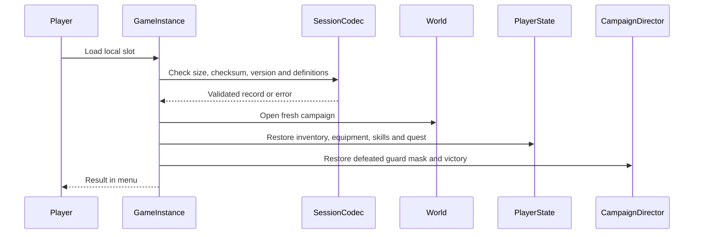

# 시작·접속·저장 흐름

시작 화면에서 혼자 시작, 방 생성, 주소로 접속, 저장 불러오기, 종료를 제공하고, 호스트의 개인 체크포인트와 세계 저장의 플레이어 프로필, 원격 플레이어의 서버 발급 신원을 구현해 별도 프로세스 재개와 다중 플레이어 복원을 검증했다. 이 문서는 세션 메뉴, 저장 형식과 검증, 복원 순서와 실패 경계, 플레이어 신원의 계약과 기록을 소유한다. [StudyRoadmap](StudyRoadmap.md)의 단계 6 사양이다. 게임 중 Esc는 같은 메뉴를 열어 저장·설정·시작 화면 복귀를 제공한다. 전투 중에도 월드는 계속 실행되며 메뉴는 해당 플레이어의 입력만 막는다.

## 하위 문서

| 문서 | 읽는 때 |
|---|---|
| [플레이어 복원](SessionFoundation/PlayerRestore.md) | 플레이어 프로필, 장비·인벤토리 복원, 다중 플레이어 준비, 원격 신원을 바꿀 때 |

## 현재 계약

이 표 아래의 절은 날짜순 설계·구현 기록이다. 뒤 절이 앞 절의 "남은 작업"을 구현하거나 계약을 바꾼 경우가 있으므로, 지금 유효한 계약은 이 표와 표가 가리키는 절을 기준으로 읽는다.

| 주제 | 현재 계약 | 정한 절 |
|---|---|---|
| 개인 체크포인트 | 단일 로컬 슬롯 `CCL_Checkpoint`에 호스트 개인 상태와 원정 체크포인트를 저장한다. 외부 세션 형식은 8(`Source/CCL/Session/CCLSessionRecord.h:52`)이며 보급품은 배치 ID로 기록한다 | [이번 저장 정책](#이번-저장-정책), [배치 식별과 체크포인트 검증](#배치-식별과-체크포인트-검증) |
| 정의 해석 | 저장의 아이템·스킬 이름은 `DA_ItemCatalog`로 해석하고 없는 이름은 거부한다 | [정의 카탈로그와 보급품 개수](#정의-카탈로그와-보급품-개수) |
| 세계 저장의 플레이어 | 세계 형식 6부터 플레이어 프로필 배열이 있고, 서버가 등록한 PlayerState를 수집·복원한다. 현재 세계 형식은 7이다(`Source/CCL/Environment/CCLWorldSnapshot.cpp:384`) | [세계 플레이어 본문 구현·검증](SessionFoundation/PlayerRestore/Profile.md#세계-플레이어-본문-구현검증), [세계 플레이어 참가자 구현·검증](SessionFoundation/PlayerRestore/Profile.md#세계-플레이어-참가자-구현검증) |
| 원격 플레이어 신원 | 서버가 첫 접속에서 비밀 키를 발급하고 재접속 때 자동으로 프로필에 연결한다. 인증이 아니다([결정 21](decisions/0021-server-issued-player-identity.md)) | [원격 플레이어 신원 연결과 복원 시 접속자 유지](SessionFoundation/PlayerRestore/Identity.md#원격-플레이어-신원-연결과-복원-시-접속자-유지) |
| 복원 중 접속자 | 저장 본문에 프로필이 없는 등록 플레이어는 거부하지 않고 현재 상태로 유지한다 | 같은 절. 세계 참가자 절의 거부 계약을 대체한다 |
| 복원 실패 경계 | 여러 Loadout의 GAS 효과를 모두 준비한 뒤 세계를 확정하고, 어느 쪽이 거부되면 기존 상태를 유지한다 | [다중 플레이어 복원 준비 경계](SessionFoundation/PlayerRestore/Loadout.md#다중-플레이어-복원-준비-경계), [인벤토리·장비 복원 준비와 실행 검증](SessionFoundation/PlayerRestore/Loadout.md#인벤토리장비-복원-준비와-실행-검증) |
| 알림 순서 | 호스트 계정·퀘스트를 확정한 뒤 보관함·플레이어 인벤토리 알림을 보낸다 | [호스트 계정·퀘스트의 알림 전 확정](SessionFoundation/PlayerRestore/Profile.md#호스트-계정퀘스트의-알림-전-확정) |
| 계정 | 조회·Tick·보상은 원장을 바꾸지 않고, 사라진 계좌는 복원 확정의 `EnsureOpen`만 다시 연다 | [계정 조회와 초기 생성 분리 구현·검증](SessionFoundation/PlayerRestore/Identity.md#계정-조회와-초기-생성-분리-구현검증), 원격 신원 절 |

남은 작업은 각 절의 마지막 문단에 있다. 그중 원격 접속의 자동 신원 연결은 2026-10-11에 구현됐다.

## 책임과 수명

| 구성 | 책임과 수명 |
|---|---|
| GameInstance | 접속 결과·보류한 불러오기와 LocalPlayer별 메뉴 핸들 |
| SessionMenuScreen·문맥 | 버튼·주소 입력·설정·성공과 실패 표시, 공용 UI 관리자의 월드 범위 화면 |
| SessionRecord와 Codec | 버전·무결성·수량·정의 ID 검증, Actor와 UI를 참조하지 않는 값 |
| Inventory·Loadout·Expedition | 검증된 개인 상태 적용, 서버 PlayerState 수명 |
| CampaignDirector | 처치 체크포인트와 남은 적 재구성, 서버 월드 수명 |

시작·일시정지 메뉴는 `UCCLSessionMenuScreen`에서 기존 Slate 본문을 표시한다. 포커스와 입력 모드는 CommonUI가 적용하며 GameInstance가 별도로 `SetInputMode`를 호출하지 않는다. 게임 중 뒤로 가기는 해당 플레이어의 메뉴를 닫고, 시작 화면에서는 메뉴를 유지한다. 메뉴를 여는 플레이어만 인벤토리·대화창을 닫는다. 맵 이동 전에는 모든 로컬 메뉴를 닫는다. 구현과 이전 검사 근거는 [UIFoundation](UIFoundation.md)을 따른다.

## 이번 저장 정책

단일 로컬 슬롯에 호스트의 인벤토리 GUID·정의 ID·수량, 장비, 학습 스킬, 포인트, 금화·퀘스트와 원정 체크포인트를 저장한다. 접속한 손님의 개인 상태는 이번 파일에 포함하지 않는다. 손님은 호스트의 파일 저장·불러오기를 요청할 수 없다. 최종 계정·협동 보상 소유권을 확정하는 정책은 아니다.

체크포인트는 처치한 경비병, 보스 격파 여부와 남은 마을 보급품이다. 호스트는 마을에서 완전한 체력으로 시작한다. Agent 스냅샷이 있는 저장은 생활 NPC와 전투 적의 부상을 복원한다. 살아 있던 전투 적은 체크포인트 위치에 재생성하며 공격 타이머는 다시 계산한다. Agent 스냅샷이 없는 이전 저장은 적의 기본 체력을 사용한다. 사망·행동 중에는 저장을 거부한다. 정확한 적 위치·공격 타이머를 직렬화하는 방식보다 재시작 상태의 일관성을 우선한 초안이다.

파일은 엔진의 플랫폼 저장 슬롯 API로 기록하되 UObject 클래스 경로를 역직렬화하지 않는다. 제한된 크기의 JSON 값 앞에 형식 식별자와 CRC를 붙인다. CRC는 우발적인 손상 감지용이며 변조 방지 장치가 아니다. 필수 필드·버전·알려진 정의 ID·수량·GUID 중복·장비 참조·스킬과 체크포인트 조합을 검증한 뒤 새 월드에 적용한다. 실패한 파일은 자동으로 덮어쓰지 않는다.

이 절을 쓸 때 저장 버전은 7이었다. 외부 세션 형식 8은 [배치 식별과 체크포인트 검증](#배치-식별과-체크포인트-검증)이 정한다. 버전 6부터 공통 세계 시계·환경·생활을 함께 저장하며, 버전 7에는 선택적인 음식 묶음 이력을 추가했다. 음식은 세계 ID·완료 시각·수량을 함께 검증하고 형식 1-6의 누락 상태는 빈 그대로 읽는다. 구현·검증 범위는 [음식 상태·인벤토리·세션 검증](EnvironmentPlan/Ecology/Food/State.md#음식-상태인벤토리세션-검증)을 따른다.

세계 저장의 등록 보관함과 호스트 개인 항목은 서로 다른 저장 소유자다. `SaveSession`은 같은 호출에서 개인 항목을 수집하고 해당 인벤토리만 세계 수집에서 제외한다. 다른 미등록 음식은 거부하며, 개인 항목과 세계 보관함의 아이템 GUID 중복도 거부한다. 불러오기는 개인 장비 효과를 먼저 준비한 뒤 세계를 복원하고 개인 인벤토리·장비·진행을 확정한다. 이는 새 맵에서의 세션 재개 순서이며 현재 월드의 개인 프로필 전체를 원자적으로 되돌리는 계약은 아니다. 일반 세계 저장·맵 전환의 개인 음식 연결은 남아 있다. 검증은 [컨테이너 세계 저장 검증](EnvironmentPlan/Ecology/Food/Containers.md#컨테이너-세계-저장-검증)을 따른다.

버전 5부터 아이템 GUID별 `LoadedAmmo`를 기록하며 형식 1-4는 탄창을 비운 상태로 변환한다. 탄약 값은 해당 무기의 탄창 용량을 넘을 수 없다. 부위는 `Equipment.Slot.*` 문자열로 기록한다. 형식 3의 enum 이름 또는 숫자는 구체적인 슬롯 태그로 변환하고, 알 수 없는 태그·상위 태그·다른 범주의 태그는 거부한다. 형식 1-3 변환과 형식 4 왕복 자동 검사, 별도 프로세스 저장·복원을 통과했다. 검사 근거는 [ProgressionFoundation](ProgressionFoundation.md)의 태그 개편 검사 표를 따른다.

각 항목에 가방 슬롯을 기록하고 장착 항목은 `INDEX_NONE`으로 표시한다. 부위별 장착 목록은 GUID를 참조하며 양손 장비는 같은 GUID로 두 손을 모두 차지해야 한다. 형식 1은 배열 순서로 가방 칸을 만들고, 형식 1·2의 단일 장비 참조는 새 부위 목록으로 변환한다. 중복 부위·잘못된 장비 종류·불완전한 양손 점유·어느 부위에도 연결되지 않은 장착 항목은 거부한다. 구현 근거는 `Source/CCL/Session/CCLSessionRecord.cpp`다.

태그 변경 전 형식 3에서는 2026-10-07 별도 프로세스로 가방 칸·장착 상태·GUID·수량·효과를 저장·복원했고 양손 장비 직렬화와 불완전한 점유 거부도 통과했다.

주소 입력은 호스트 이름 또는 IPv4와 선택적인 포트만 허용한다. URL 옵션·경로·공백·범위를 벗어난 포트는 거부한다. LAN 또는 직접 접속이 가능한 호스트 주소를 쓰며 매치메이킹·계정·NAT 중계는 이번 범위가 아니다. 접속·이동 실패는 엔진 이벤트를 받아 메뉴에 표시한다.

설정은 엔진 GameUserSettings의 화면 품질과 창 모드를 사용한다. 입력은 메뉴 버튼으로 적용하고 저장하며 다음 실행에도 유지한다. 원격 서버나 다른 플레이어의 설정을 바꾸지 않는다.

## 기존 구현 검증 결과

2026-10-07 UE 5.9에서 프로젝트 생성 BAT·CCLEditor 빌드·시작 맵 저장을 통과했다. 서로 다른 프로세스의 저장·불러오기에서 GUID·수량·장비·두 스킬·체력·금화·퀘스트와 부분 처치 상태를 확인했다. 이미 수집한 보급품은 복원하지 않았다. 메뉴 복귀 후 재불러오기, 남은 경비병 처치로 보스 진입, 승리 저장·복원 후 적이 없는 상태도 통과했다.

잘못된 주소, 손상된 실제 검증 슬롯, 모르는 버전·정의, 음수 수량, 중복 GUID와 없는 장비 참조를 거부했다. 화면 품질 변경과 설정 파일 재읽기로 저장을 확인했다. 별도 호스트·클라이언트가 메뉴의 접속 경로로 연결됐고 손님의 호스트 저장 요청은 거부됐다. 존재하지 않는 포트의 접속 실패도 메뉴에 표시됐다.

실제 Slate 첫 버튼에 Enter 입력을 보내 새 원정을 시작했다. 전체 버튼의 수동 마우스 조작과 화면 모드 전환은 미확인이다. 화면 검토에서 글자 크기·문구 잘림·키보드 포커스를 수정한 뒤 최종 렌더링과 저장 검사를 다시 통과했다. 시작·불러온 인벤토리·게임 중 메뉴 화면을 확인했다. 콘텐츠 Standalone, 성장 Dedicated, 전투 Listen 회귀도 통과했다. 패키징 실행은 단계 7에서 별도로 검사한다. 그 결과는 [Packaging](Packaging.md)이 소유한다.

| 검사 | 로컬 근거 |
|---|---|
| 생성·빌드·시작 맵 | |
| 최종 저장·불러오기·키보드·화면 | |
| 방 생성·접속, 접속 실패 | |
| 콘텐츠·성장·전투 회귀 | |
| 화면 | |

테스트는 `CCL_Validation` 슬롯을 쓰며 일반 플레이의 `CCL_Checkpoint` 슬롯과 구분한다. 로컬 저장 파일은 Git에 넣지 않는다. 엔진 API 근거는 `<Engine>/Source/Runtime/Engine/Private/GameplayStatics.cpp:2215`의 `SaveDataToSlot`과 같은 파일 2316행의 `LoadDataFromSlot` 경로와 `Engine.h:2390`의 `OnNetworkFailure` 이벤트다.

Agent 생활 저장 통합은 결정 18과 [AgentFoundation](AgentFoundation.md)을 따른다. v5에는 선택적 `AgentSimulation` 스냅샷과 `AccountId`가 추가된다. 계정이 포함된 저장의 이전 `Coins` 필드는 0이며, 옛 저장에만 금화 이관 값으로 쓰인다. 생활 스냅샷은 Unreal 구조체 기반 로컬 저장이므로 JSON의 Definition 허용 목록과 별개로 Feature 타입·버전·교차 참조를 검증한다. 신뢰할 수 없는 외부 저장 파일을 안전하게 읽는 보안 경계로 사용하지 않는다.

## 정의 카탈로그와 보급품 개수

2026-10-11부터 저장 기록의 아이템·스킬 이름은 코드 목록이 아니라 콘텐츠 카탈로그로 해석한다. `UCCLItemCatalogSettings`가 `DefaultGame.ini`에서 `/Game/Progression/DA_ItemCatalog`를 지정한다. `UCCLItemCatalog`의 `Items`와 `TrainingSkills`에 없는 이름은 null로 해석되어 저장 검증에서 거부된다. 임의 경로를 불러오지 않는다는 기존 계약은 유지한다. 카탈로그는 `/Game/Progression`의 항상 쿠킹 목록에 포함된다.

같은 날 카탈로그의 이름 유일성을 추가했다. 같은 종류의 항목 안에서 이름은 유일해야 하고, 같은 객체의 중복 등록과 빈 참조도 검증 오류다. 아이템과 스킬은 별도 이름 영역을 유지한다. 에디터 Data Validation과 런타임 `Get`에서 전체 카탈로그를 검증하며, 직접 `FindItem`·`FindSkill`을 호출해도 중복 이름을 첫 항목으로 해석하지 않는다. 기존 이름 기반 저장 형식은 바꾸지 않았으므로 정의의 이름 변경은 이 검사로 해결되지 않는다. 검증 근거는 [ProgressionFoundation의 2026-10-11 기록](ProgressionFoundation/Verification.md#2026-10-11-설계-후속-수정)이다.

남은 마을 보급품은 정의 이름의 집합이 아니라 남은 픽업마다 한 번씩 기록한다. 같은 정의의 픽업이 둘 있고 하나를 주웠다면 이름이 한 번만 남는다. 복원은 이름별 개수만큼 픽업을 남기고 나머지를 제거한다. 이전 방식은 같은 정의의 픽업 하나를 주운 뒤 저장하면 둘 다 되살렸다. 형식 5부터 보급품 기록은 최대 64개이고 그 전 형식은 기존 상한 2개를 따른다. 승리 기록은 처치한 경비병 비트가 하나 이상 있어야 하며, 비트 값은 0-255 범위다. 구현은 `Source/CCL/Session/CCLSessionRecord.cpp`와 `Source/CCL/Session/CCLGameInstance.cpp`의 `ApplyRecord`다.

## 배치 식별과 체크포인트 검증

경비 1·2와 보스 3의 Agent ID를 유지하고 세 번째 이후 경비는 4부터 배정한다. 경비 배열 순서 변경은 기존 처치 마스크와 함께 별도 호환성 판단이 필요하다. 구형 저장에서 세 명 이상의 경비가 사용한 충돌 상태는 자동 분리하지 않는다.

보급품은 맵에 저장한 `PlacementId`와 정의·남은 수량으로 저장한다. Director가 자신이 생성한 픽업만 추적하며 음식의 세계 저장용 `PersistentId`는 재사용하지 않는다. 외부 세션 형식은 8로 확장하고 구형 세션은 배치가 확실한 기본 구성만 변환한다. 모호한 구형 저장은 원본을 보존하고 적용 전에 거부한다. 배치 ID·정의·수량과 처치 마스크는 세계·플레이어 복원보다 먼저 검증한다.

검증 대상은 경비 1·2·3·8명과 보스의 ID 고유성, 같은 정의의 서로 다른 두 배치·수량 복원, 설정 순서 변경, 잘못된 배치 거부, 구형 저장과 프로필 회귀다. 최종 프로젝트 파일 생성·Editor 빌드 뒤 자동화와 별도 프로세스 세션 재개를 실행한다. UE 5.8.3에서 프로젝트 파일 생성과 Editor 빌드를 통과했다. 전체 자동화는 155개가 통과했고 실패·미실행은 없다. 실제 저장·별도 프로세스 재개·승리 복원은 통과했다. 맵에 직접 배치됐던 장갑·포션은 `create_progression.py`로 Director의 배치에 이전했다. 5개 배치를 확인했다. 앞의 정의별 개수 복원 설명은 형식 7까지의 이력이며 형식 8은 이 절의 배치 식별을 사용한다.
