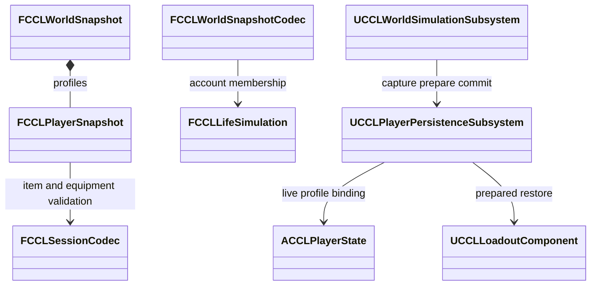

# 세계 플레이어 프로필

일반 세계 저장과 맵 전환에서 플레이어의 회수 음식, 장비, 스킬, 포인트, 퀘스트, 계정 연결을 같은 세대에 넣는 계약이다. 본문의 세계 형식 6은 도입 당시 값이고, 형식 7의 구간 구조는 [세계 저장 참여](../../EnvironmentPlan/Persistence.md#세계-저장-참여와-맵-도메인)가 소유한다. 검증은 2026-10-10 UE 5.8.3의 EnvironmentScenario Standalone이다.

## 공통 세계의 플레이어 프로필 설계

`FCCLPlayerSnapshot`은 식별 키, 계정 ID, 항목, 장비 슬롯, 스킬, 포인트, 퀘스트, 체력과 스태미나 비율, 가방 용량, 음식 보관 조건을 소유한다. 계정 잔액은 LifeSimulation의 경제 원장에만 저장하고 프로필은 참조만 복원한다.

- **별도 이진 본문:** 기존 JSON 세션을 그대로 넣으면 세계 저장이 재귀적으로 들어갈 수 있다. 그래서 제한된 값만 가진 본문을 쓰고 중첩 세계 스냅샷을 넣지 않는다. 본문 버전은 1이고 세계 CRC 범위에 들어간다.
- **한도:** 최대 64명, 전체 4,096개 항목, 8MiB이고 식별 키는 최대 192자의 정규화된 소문자 ASCII다. 직렬화 예산이고 동시 접속 성능 보장 수치가 아니다.
- **검증:** 값 검증기는 Actor를 만들지 않고 개수, 길이, 음식 시각, 장비 참조, 계정 존재, 중복 GUID를 본다. 인벤토리와 장비 검증은 `FCCLSessionCodec::ValidateProfile`과 공유한다. 이 경로는 중첩 세계, 별도 금화, 호스트 체크포인트를 받지 않아 재귀 호출을 막는다.
- **중복 소유:** 플레이어 사이의 식별 키, 계정, 아이템 중복과 플레이어, 세계 보관함, 바닥 픽업 사이의 아이템 중복을 거부한다. 개인 세션의 바깥 항목과 중첩 세계의 프로필도 소유권을 중복할 수 없다.
- **이전 저장:** 세계 형식 1-5는 빈 프로필 배열과 `bPlayersMigrated` 표시로 읽고 프로필이나 계정을 만들어 넣지 않는다. 빈 배열을 읽었다는 이유로 현재 플레이어의 음식과 계정 연결을 조용히 누락하지 않는다.

## 세계 플레이어 본문 구현·검증

| 검사 | 결과 |
|---|---|
| 프로필과 세계 값 검증, 기존 자동 검사 | 143/143, 경고, 실패, 미실행 0 |
| 개인 음식과 장비의 별도 프로세스 재개 | 세션 형식 7 호스트 저장과 읽기 통과 |
| 세계와 지형 맵 네 번 왕복 | Standalone 통과 |
| 바닥 음식 픽업의 저장, 복원, 새 프로세스 재개 | Standalone 통과 |

자동 검사는 프로필, 양손 점유, 음식, 부상 비율, 계정 잔액의 왕복과 불완전한 점유, 잘못된 참조, 음식 시각, 수량, 중복 소유권의 거부, 실패 출력 보존을 본다. 정상 프로필 64명과 65명, 정상 항목 4,096개와 4,097개를 각각 대조했다. 잘못된 UTF-8, 큰 길이, 큰 배열 수, 잘림, 뒷부분 추가도 거부했다. 저장을 읽는 보안과 인증 경계 전체를 검증한 결과는 아니다.

맵 왕복 검사의 비교 후보는 실제 `UCCLInventoryPersistenceSubsystem::Capture` 결과를 쓴다. 저장된 값을 비교 후보에 복사하지 않는다.

## 세계 플레이어 참가자 구현·검증

`UCCLPlayerPersistenceSubsystem`은 서버가 등록한 식별 키와 살아 있는 PlayerState의 연결, 표현이 없는 프로필 기록을 소유한다. `Bind`는 서버 코드 전용이고 클라이언트가 보낸 계정 ID를 인증하는 API가 아니다. 세계 저장은 참가자가 수집한 프로필과 보관함을 같은 본문에 기록한다. 호스트 개인 세션은 바깥 항목의 소유자를 명시적으로 뺀다.

복원 순서는 다음과 같다.

1. 연결된 프로필의 항목과 스킬을 해석한다. 현재 가방 용량과 저장 용량이 다르거나 행동, 사망 상태가 Loadout 복원을 막으면 세계 변경 전에 거부한다.
2. 참가자의 Loadout 요청과 선택적인 개인 세션 요청을 하나로 묶는다.
3. 세계 모델과 보관함 배열을 확정한다.
4. 계정 참조, 퀘스트, 음식 보관 조건, 체력, 스태미나를 적용한다.
5. 보관함 알림과 플레이어 인벤토리 알림을 보낸다.

동적 음식은 온라인 기록과 표현 없는 기록 모두 같은 세계 진행의 준비, 취소, 확정에 참가한다. 저장 본문에 프로필이 없는 등록 플레이어의 처리는 [접속자 유지](Identity.md#원격-플레이어-신원-연결과-복원-시-접속자-유지)를 따른다.

| 검사 | 결과 |
|---|---|
| 실제 프로필, 보관함, 음식 진행, 새 세계 시작 | 쓰기와 읽기 종료 코드 0 |
| 기존 CCL 자동 검사 | 143/143, 경고, 실패, 미실행 0 |
| 개인 세션 재개, 동적 보관함 새 프로세스 재개 | 통과 |

- 실제 음식 드롭과 회수 뒤 두 PlayerState와 보관함을 함께 저장했다. 장비, 스킬, 포인트, 퀘스트, 체력, 스태미나, 계정 잔액, 음식을 바꾼 뒤 복원해 플레이어 본문 전체 바이트를 대조했다.
- 뒤 대상의 두 번째 GAS 효과를 거부하면 세계 Epoch, 계정, 보관함, 양쪽 프로필이 유지됐다. 정상 복원에서는 보관함과 두 플레이어의 알림 3회가 모두 최종 개인 값을 관측했다.
- 등록을 해제한 플레이어의 기록을 새 PlayerState에 연결해 기존 계정과 부상을 복원했다. 세계 진행 실패에서 온라인과 연결 해제 음식이 유지됐고, 같은 보류 시간을 재시도해 둘 다 완료 시각에 도달했다.
- 읽기 프로세스는 GameInstance 초기화 때 저장 파일을 `UCCLAgentSessionStore`에 넣고 실제 `WorldSimulation::Start`가 읽게 한다. 두 실제 PlayerState의 본문과 계정 잔액 79, 83을 대조했다. 테스트용 서버 키를 직접 등록한 결과이고 자동 로그인 인증 검증이 아니다.

실제 두 원격 클라이언트의 소유자 복제, 지연, 손실은 이 검증에 없다.

## 호스트 계정·퀘스트의 알림 전 확정

호스트 개인 세션의 계정과 퀘스트는 보관함과 플레이어 인벤토리의 복원 알림 전에 확정한다. 콜백 전달은 준비 계약을 늘리지만 UI 구독자마다 복원 순서를 추측하지 않게 한다.

- `UCCLGameInstance::ApplyRecord`가 값, 정의, 계정 원장 참조, 현재 컴포넌트를 검사한 뒤 동기 확정 콜백 `FinalizeProfile`을 만든다.
- 세계가 있는 세션은 `AgentWorldSubsystem::Restore`와 `WorldSimulationSubsystem::Restore`를 통해 콜백을 넘긴다. 세계가 없는 이전 개인 저장은 Loadout 복원의 마지막 단계에 쓴다.
- 콜백은 성공한 복원 안에서 한 번만 실행하고, 실패하거나 객체를 파괴하거나 복원을 다시 호출하지 않는다. 세계 복원 API는 개인 참가자 없이 콜백만 넘기는 호출을 거부한다.

| 검사 | 결과 |
|---|---|
| 호스트와 보관함 알림, 실패 보존, 이전 금화 이관 | 통과 |
| 별도 프로세스 재개, 메뉴 재진입, 승리 재개 | 통과 |
| 다중 플레이어, 동적 음식, 새 프로세스 세계 시작 | 통과 |
| 기존 CCL 자동 검사 | 143/143, 경고, 실패, 미실행 0 |

실제 `ApplyRecord`에서 호스트와 보관함의 알림 두 번이 저장 계정, 잔액 20, 수락한 퀘스트, 포인트, 체력 125를 관측했다. 알림에서 잔액을 조회해도 계좌 개수가 저장 값과 같았고 복원 전에 연결했던 다른 계좌는 다시 생기지 않았다. 없는 계정 참조와 GAS 거부에서는 알림 0회와 함께 모든 값이 유지됐다. 세계 본문이 없는 개인 저장은 금화 41과 미수락 퀘스트를 먼저 이관하고 알림을 한 번 보냈다. 실행 검사는 `Source/CCL/Tests/CCLSessionPublicationSmoke.cpp`의 `CheckPublication`이 소유한다.

캠페인 적 생성과 보급품 정리는 `ApplyRecord`의 별도 후처리이고, 그 실패까지 되돌리지 않는다. GAS의 개별 Attribute 콜백이나 임의 외부 코드까지 같은 관측 시점으로 묶은 결과도 아니다.
