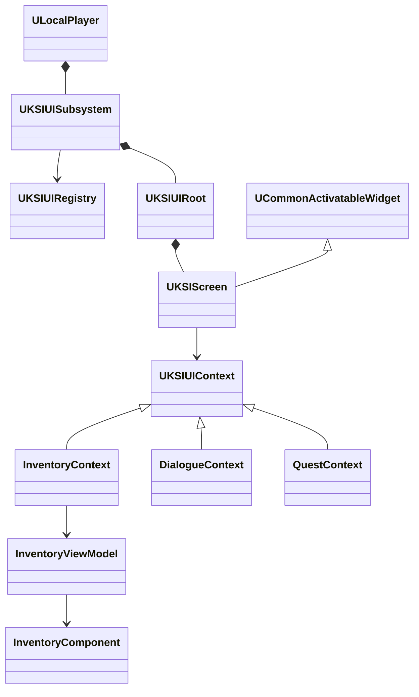

# 공용 UI 기반

`KSIUI` 모듈의 공용 UI가 로컬 플레이어마다 화면의 수명·배치·입력을 관리하고, 인벤토리·NPC 대화·퀘스트·지도·능력치의 규칙은 기능별 문맥과 표시 모델이 맡는다. 관리자·루트·레이어·등록·문맥·화면 풀, 그룹별 숨김·입력·갱신 정지·페이드를 구현했고 인벤토리·장비·시작·일시정지 메뉴와 HUD·대화창을 옮겨 중첩 요청, 맵 이동, 실제 입력 검사를 통과했다. 이 문서는 공용 UI의 계약, 기능 연결 방식, 검증 기록을 소유한다. 근거는 [결정 17](decisions/0017-genre-independent-ui.md)이다.

`Source/KSIUI/`가 등록 데이터·플레이어별 관리자·문맥·화면 베이스·루트를 제공한다. 모듈 이동·호환 검증은 [FrameworkPlan](FrameworkPlan.md#단계-1-구현-범위와-검증-기준)이 소유한다. 공용 기반의 검사 통과가 대화 선택지·퀘스트 목록 같은 개별 콘텐츠 화면의 완성을 뜻하지는 않는다.

## 목표와 경계

`Source/KSIUI/`는 Character, Inventory, GAS, 퀘스트 상태를 직접 참조하지 않는다. 화면 태그는 종류를, 핸들은 열린 창 하나를 식별한다. 같은 종류의 창도 비교 대상이나 퀘스트 문맥이 다르면 따로 열 수 있다. 콘텐츠는 등록 데이터를 바꾸거나 기능을 등록해 공용 코드를 고치지 않고 화면을 추가한다.

기본 구현은 UMG와 CommonUI를 쓴다. 스택은 메뉴와 확인 창, 겹침 패널은 HUD·동시 표시 도구, 큐는 순서대로 표시하는 알림에 쓴다. 특정 장르의 화면 목록과 레이어 수를 공용 관리자에 고정하지 않는다. 지도 표시 데이터는 미니맵·전체맵이 공유할 수 있지만 확대·이동 같은 화면 상태는 각 창이 소유한다. MP·버프·월드 상호작용 아이콘의 데이터 제공자를 연결할 수 있어야 하며, 공용 UI가 새 마나·버프 게임 규칙을 만들지는 않는다.

## 책임과 수명

| 구성 | 소유자·수명 | 책임 |
|---|---|---|
| `UKSIUISubsystem` | `ULocalPlayer` | 화면 등록, 인스턴스·비동기 요청 핸들, 루트 연결과 정리 |
| `UKSIUIRegistry` | 공유 DataAsset | 화면 클래스·문맥 타입·레이어·그룹·인스턴스 정책 정의 |
| `UKSIUIRoot` | 플레이어 관리자 | 데이터로 구성한 레이어와 태그 확장 지점, 실제 위젯 배치 |
| `UKSIScreen` | 루트/위젯 풀 | 활성화·문맥 연결·연결 해제와 닫기 요청의 공통 계약 |
| `UKSIUIContext` 파생형 | 요청 또는 열린 화면 | 기능별 표시 문맥; 게임 상태의 소유권을 넘겨받지 않음 |
| 기능별 표시 모델 | 해당 기능 | 데이터 변경 구독과 표시 값 통지; GAS 등은 기능별 어댑터로 연결 |
| 표시 제어 요청 | 요청 소유자와 지정 범위 | 그룹 숨김·입력 억제·페이드·갱신 정지 정책 |

모두 클라이언트 로컬 표현이다. 서버의 보유 아이템·장착·거래·퀘스트 검증은 UI가 대신하지 않는다. 등록 소유자가 사라지면 해당 등록과 보류 요청·화면을 해제한다. 기본 화면 범위는 월드이며 맵 이동 때 닫는다. 로컬 플레이어 범위 화면도 PlayerController 참조를 고정하지 않고 새 컨트롤러에 재연결한다.



## 공개 계약

화면·등록·비동기 요청·표시 제어 핸들은 서로 다른 타입이다. 유효하지 않거나 이미 해제한 핸들의 닫기·취소·해제는 안전하게 실패한다. 잘못된 문맥 타입, 중복 화면 태그, 없는 레이어·확장 지점은 화면을 만들기 전에 거부한다. 인스턴스 정책은 플레이어별 단일 창, 문맥별 단일 창, 여러 창을 구분한다.

```cpp
FKSIUIRegistrationHandle RegisterView(const FKSIUIViewDefinition& Definition, UObject* Owner);
void UnregisterView(FKSIUIRegistrationHandle Registration);
FKSIUIViewHandle OpenView(FGameplayTag View, UKSIUIContext* Context, UObject* Owner);
FKSIUIRequestHandle RequestOpenView(FGameplayTag View, UKSIUIContext* Context, UObject* Owner);
void CancelRequest(FKSIUIRequestHandle Request);
void CloseView(FKSIUIViewHandle View);
FKSIUIPresentationHandle PushPresentation(const FKSIUIPresentationDefinition& Definition, UObject* Owner);
void ReleasePresentation(FKSIUIPresentationHandle Request);
bool SetBasePresentation(FKSIUIViewHandle View, const FKSIUIViewPresentation& State);
```

`OpenView`는 이미 로드된 클래스에만 쓴다. Soft Class가 아직 로드되지 않았으면 비동기 요청을 쓴다. 완료 콜백은 요청이 아직 유효한지, 등록·소유자·월드가 같은지 확인한 뒤 화면을 만든다. 취소한 요청이나 이전 월드의 콜백은 새 화면을 열지 못한다. 화면 풀에서 재사용할 때는 이전 문맥과 델리게이트·포커스 참조를 먼저 해제한다. Construct/Destruct만으로 연결 수명을 처리하지 않는다.

단일 창을 교체하는 도중 같은 등록을 다시 여는 호출은 거부한다. `CloseAllViews`의 닫기 콜백에서도 새 창을 열 수 없다. 그 밖의 일반 닫기 완료 콜백은 다음 화면을 열 수 있다. 플레이어 범위 화면은 맵 이동 후 처음 열린 순서대로 다시 붙여 스택과 큐의 순서를 보존한다. 초기 표시 정책의 기능 콜백이 화면을 닫으면 `OpenView`는 유효한 핸들을 반환하지 않는다.

기능 연결의 형태는 다음과 같다.

```cpp
const FKSIUIViewHandle View = UI->OpenView(ViewTag, InventoryContext, FeatureOwner);
// 기능 종료는 화면 핸들만 닫으며 다른 문맥의 같은 종류 화면에는 영향을 주지 않는다.
UI->CloseView(View);
```

## 입력

CommonUI의 Action Router가 최종 UI 입력 설정을 적용한다. 콘텐츠 화면은 각자 `SetInputMode`를 호출하지 않는다. `Source/CCL/`의 UI별 직접 입력 모드·뷰포트 추가 호출은 제거됐다. 전투 행동 가능 여부는 게임플레이가 판단한다. 새 화면의 포커스를 지정하고 닫을 때 아직 유효한 이전 화면으로 복원한다. 드래그 중 닫기·컨트롤러 교체 때는 드래그와 눌린 입력을 해제한다.

레지스트리는 루트 활성화 때 적용할 Enhanced Input 매핑과 우선순위를 지정할 수 있다. ccl8의 `UCCLUIInputData`는 Escape·게임패드 취소와 Enter·게임패드 확인의 기본 액션을 제공하고, 공용 기반에는 구체적인 키를 고정하지 않는다. 뒤로 가기 바인딩은 Menu·GameAndUI 화면에만 연결하고 문맥 해제 때 제거한다. 상시 표시용 Inherit 화면은 활성 메뉴의 닫기 입력을 소비하지 않는다. Menu 정책은 이동·시점 입력도 무시하며 닫을 때 루트의 Game 정책으로 돌아간다. UI가 키를 처리하지 않는 게임 상태에서는 같은 키의 게임 액션이 계속 실행되도록 공용 액션의 Enhanced Input 소비를 끈다.

## 표시 제어

연출 요청은 그룹별 표시, 입력, 갱신 정책을 구분한다. 복구는 과거의 표시 상태를 통째로 덮어쓰지 않고 현재 기본 상태와 남아 있는 요청에서 다시 계산한다. 컷신·사망 요청을 반대 순서로 해제하거나 같은 핸들을 두 번 해제해도 다른 요청은 유지된다. 페이드 중 UI 입력은 막고 완료 후 현재 정책에 따라 복구한다. 화면 닫기와 잠시 숨기기는 다른 동작이다.

표시 제어 요청은 소유자·월드 범위가 있는 별도 핸들이다. 태그 그룹을 선택하거나 전체 화면을 명시하며, 숨김·UI 입력 차단·표시 갱신 정지·불투명도 제한을 합성한다. 숨김과 차단은 요청 하나라도 요구하면 유지하고 불투명도는 가장 낮은 제한을 따른다. 게임 입력 차단은 해당 로컬 플레이어 전체에 적용하는 별도 옵션이다. 페이드 시작 시 대상 UI 입력을 막고 복구 페이드가 끝나면 허용한다. 관리자의 Tick에서 페이드를 진행하므로 숨긴 위젯의 Tick에 복구를 의존하지 않는다. 월드 정리 Tick 직전에도 이전 월드의 요청은 입력·표시 계산에서 빠진다.

CommonUI 스택의 비활성화는 화면 제거로 이어질 수 있으므로 일시 숨김은 활성화 상태와 핸들을 보존한다. 화면의 입력·포커스 참여만 조정하고 CommonUI Action Router의 파생형에서 현재 루트의 입력 경로를 갱신한다. 게임 입력 정책은 현재 루트·화면의 요구에서 다시 계산하며 과거 입력 모드를 저장해 되돌리지 않는다. 인벤토리 미리보기는 갱신 정지 중 캡처를 멈추고, HUD는 데이터 구독을 유지하면서 표시 갱신을 보류했다가 복구 시 최신 값을 읽는다. 게임 상태와 상호작용 유효성 검사는 계속 실행한다.

실제 컷신 에셋이나 사망 연출 타임라인은 없다. 해당 기능이 요청 핸들을 소유하도록 연결할 수 있는 기반만 검증했다.

## 뷰포트 가장자리 배치

HUD는 실제 뷰포트를 채우는 Canvas를 루트로 쓴다. 1280×720 고정 캔버스를 `ScaleToFit`으로 감싸면 넓은 화면의 여백 때문에 앵커가 실제 화면 끝을 가리키지 않는다. DPI에 따른 글자·패널 크기 조정과 화면 가장자리 배치는 나눠 처리한다. 새 UMG 화면은 1280×720 설계 크기를 ScaleBox로 맞춰 프로젝트 DPI 배율 때문에 글자가 작아지지 않게 한다.

메뉴에서 월드를 클릭할 때는 Slate 절대 좌표를 `USlateBlueprintLibrary::AbsoluteToViewport`의 픽셀 좌표로 바꾼 뒤 역투영한다. 위젯 로컬 좌표를 픽셀로 쓰지 않는다. 엔진 근거는 `<Engine>/Source/Runtime/UMG/Private/SlateBlueprintLibrary.cpp:71`과 `<Engine>/Source/Runtime/Engine/Private/SceneView.cpp:1542`다. 해상도별 실제 클릭과 대상 변경 결과를 함께 확인한다. 배치·조작법과 실행 근거는 [실험실 배치와 관측 도구](EnvironmentPlan.md#실험실-배치와-관측-도구)가 소유한다.

## 기능 연결

`CCLGameUI::Get`은 콘텐츠 계층의 기본 레지스트리를 구성한다. 일반 게임 컨트롤러를 기준으로 루트 입력 정책을 활성화하며 공용 Core에는 구체적인 게임 화면 의존성이 없다.

- **HUD와 능력치**: `ACCLHUD`가 로컬 기능 문맥을 소유하고 공용 관리자에서 능력치 화면과 안내 화면을 연다. `UCCLCombatViewModel`은 MVVM FieldNotify로 GAS 변경을 전달하고 능력치 위젯은 그 통지를 구독한다. 퀘스트·적 패턴·근접 상호작용은 기능 계층에서 주기적으로 조회하되 문자열이 바뀔 때만 위젯을 갱신한다. 위치 변화에는 조회가 필요하며 공용 관리자에 게임 월드 검색을 넣지 않는다.
- **NPC 대화**: 대사 문맥은 컨트롤러의 서버 응답을 받아 변경을 알리고, 거리·생존 검사는 화면 표시 여부와 무관하게 컨트롤러가 한다. 서버 응답이 늦게 도착하면 현재 생존·거리와 인벤토리·메뉴 표시 상태를 다시 확인해, 사망한 캐릭터의 대화를 열거나 그 뒤에 연 인벤토리를 닫는 응답을 거부한다. 서버의 거래·퀘스트 판정은 그대로이고 클라이언트 표시만 제한한다.
- **인벤토리**: `UCCLInventoryContext`가 선택 상태와 미리보기 캡처를, `UCCLInventoryScreen`이 Slate 본문과 문맥 연결을 소유한다. 화면이 닫히면 해당 플레이어의 드래그·눌린 입력과 캡처를 정리한다. 컨트롤러는 공용 관리자에서 얻은 화면 핸들과 서버 요청 경로를 쓴다. 기능별 Slate 본문을 `UNativeWidgetHost`에 넣어 슬롯·버튼 동작을 유지하지만, UMG에서 그 내부 배치를 직접 편집할 수는 없다. 화면 전체를 새 UMG 트리로 다시 만드는 대안은 시각 편집에 유리하지만 입력·드래그 회귀 범위를 함께 늘려 택하지 않았다.
- **시작·일시정지 메뉴**: `UCCLSessionMenuScreen`이 맡아 최종 입력 설정을 CommonUI 한 경로에서 적용한다. 세션 메뉴 핸들은 LocalPlayer별로 보관해 두 번째 플레이어가 메뉴를 열 때 첫 번째 플레이어의 인벤토리를 닫지 않는다. 화면·문맥은 플레이어별로 분리되지만, 여러 플레이어가 데스크톱 마우스 하나의 캡처를 독립적으로 쓰는 것은 보장하지 않는다. CommonUI의 `CommonUIActionRouterBase.cpp:2073`에도 공유 뷰포트의 마우스 캡처 제약이 있다.

선택지 분기와 여러 퀘스트 목록은 별도 콘텐츠 구현이다. 퀘스트 추적·알림도 같은 등록 계약에 연결할 수 있어야 한다.

## 검증 방법

- `CCL.UI.RegistryContracts`는 레이어·확장 지점·중복 태그·문맥 검증과 재연결 시 이전 콜백 해제를 검사한다. `CCL.UI.ViewModelLifetime`은 이전 ASC의 알림 해제, 새 ASC 연결, 같은 원본 재연결 때 중복 알림 방지를 검사한다.
- `Tools/Validation/run_ui_foundation.ps1`은 실제 게임 프로세스에서 동시 패널, 스택·큐, 풀 재사용, 미로드 클래스의 비동기 로딩 취소, 등록 소유자 제거, 로컬 플레이어 분리, 뒤로 가기 입력, 맵 이동을 검사한다. 필요한 Soft Class 에셋은 `Tools/Validation/create_ui_fixture.py`가 만든다. `UCCLUICloseOnHideProbe`는 초기 표시 정책의 콜백이 화면을 닫는 경로를 재현한다.
- 표시 제어 검사는 중첩 요청의 양방향 해제·중복 해제, 숨긴 상태에서 기본 표시값 변경·새 화면 열기, 소유자 소멸·맵 이동·플레이어 분리, 페이드 도중 역전, 입력과 포커스 복구, 캡처 정지, 숨김 중 사망을 포함한다. 같은 화면 등록 계약에 RPG HUD, RTS 동시 도구 패널, 대화 전용 표시 정책을 대입한다.
- 통합 검사는 Dedicated·Listen 호스트·지연/손실 클라이언트, 저장 파일의 별도 프로세스 복원, 접속·실패 메뉴를 대상으로 한다. 공용 수명 검사에는 RTS의 자원·선택·미니맵 동시 패널과 대화 중심 게임의 본문·선택지 스택을 별도 레지스트리로 구성한다. 이 예시는 게임 규칙이나 완성된 화면 에셋을 추가하지 않고 등록 데이터·입력 정책의 교체 가능성을 본다. 월드 일시정지 중 페이드와 숨긴 화면의 복구도 실제 프레임에서 본다.
- HUD·대화 검사는 능력치 변경 통지, 재스폰 후 ASC 재연결, 이전 구독 해제, 대사 교체·거리 이탈·사망·인벤토리 전환, 720p·1080p 배치, 입력 회귀를 포함한다. 실제 GAS 체력 변경이 FieldNotify를 거쳐 표시 문자열까지 동기적으로 갱신되는 경로도 게임 검사에 들어 있다.

실행 로그에는 엔진 실험 플러그인 ToolsetRegistry의 `PythonTestRunner` 초기화 오류가 따로 나타난다. 판정은 공용 UI 검사 실패·입력 라우터 오류·assert·fatal과 종료 코드로 하며, 이 플러그인 초기화 문제를 UI의 무오류 검증으로 취급하지 않는다. 실행 순서와 증거 기록은 `ccl8-verify` 스킬을 따른다.

## 직접 확인

`CCL.uproject`에서 Campaign 맵을 실행해 아래 화면을 본다. 조작은 2026-10-08 통합 당시 기준이다.

1. 왼쪽 위 체력·기력과 아래쪽 안내 글자의 크기를 확인한다.
2. `I`로 인벤토리를 연다. 중앙 캐릭터와 양옆 장비 슬롯, 오른쪽 가방을 확인한다.
3. 아이템을 빈 칸과 다른 아이템 칸으로 드래그한다. 한손 장비 양쪽을 장착한 뒤 양손 장비로 교체해 반환된 아이템을 확인한다.
4. 인벤토리를 닫고 마을 안내인 근처에서 `T`를 누른다. 중앙 아래 대화 상자의 이름과 본문을 확인한다.
5. `Esc`로 메뉴를 열었다 닫는다. 캐릭터 조작이 복구되는지 확인한다.

연출 요청은 기반 API로 제공하며 일반 플레이에 컷신 단축키를 추가하지 않았다. 자동 실행으로 저장한 비교용 화면은 로컬 `Saved/Tests/UIVisual/1920x1080-20261008-100611/`의 `equipment-full.png`(장비 창), `npc-dialogue.png`(대화창), `presentation-dialogue-only.png`(HUD 그룹을 숨기고 대화창만 남긴 상태)다.

## 이전과 검증

아래는 2026-10-07-08의 기록이다. 경로는 저장소 기준이다. 장비 계약은 [ProgressionFoundation](ProgressionFoundation.md)이 소유한다.

| 구현 묶음 | 커밋 |
|---|---|
| 장비 태그 | `6a9cecb` |
| 공용 UI 기반 | `b5d9495` |
| 인벤토리·메뉴 이전 | `494a0ac` |
| HUD·대화창 | `bbe9b3b` |
| 표시 제어 | `37dd904` |
| 통합 | `b6cc535` |

### 2026-10-07 공용 기반

생성 BAT와 전체 Editor 빌드 근거는 `Saved/StageValidation/UI-Generate.log`, `UI-Build.log`다. `CCL.UI.RegistryContracts`는 `Saved/Tests/Automation/20261007-235614-219/report/index.json`에서 성공했다. `run_ui_foundation.ps1`은 `Saved/Tests/UIFoundation/20261007-235928/game.log`에서 통과했고, 맵 이동 후 스택 순서 보존과 닫기 콜백 재진입 거부도 확인했다.

### 2026-10-08 인벤토리·메뉴 이전

인벤토리 화면을 서버 RPC는 그대로 둔 채 공용 화면으로 옮기고, 시작·일시정지 메뉴도 옮겼다.

| 인벤토리·메뉴 이전 검사 | 로컬 근거와 결과 |
|---|---|
| 최종 생성 BAT·전체 Editor 빌드 | `Saved/StageValidation/UIInventory-Generate.log`, `UIInventory-Build.log`, 성공 |
| 실제 포인터 이동·교환·장착·해제, 드래그 중 닫기, 풀 재사용, 메뉴 입력, 재스폰 | `Saved/Tests/UIVisual/1280x720-20261008-001933/game.log`, 통과 |
| 위 검사와 로컬 플레이어별 메뉴·인벤토리 분리 | `Saved/Tests/UIVisual/1920x1080-20261008-002538/game.log`, 통과 |
| Listen 원격 장착·복제·원정·개별 재스폰 | `Saved/Tests/CampaignSmoke/Listen-20261008-002532/`, 서버·클라이언트 통과 |
| 기본 레지스트리 연결 후 공용 수명 계약 회귀 | `Saved/Tests/UIFoundation/20261008-002702/game.log`, 통과 |
| 시작 메뉴 키보드 입력·맵 이동·별도 프로세스 저장·복원 | `Saved/Tests/SessionSmoke/20261008-002754/write.log`, `read.log`, 통과 |

두 UI 검사 폴더의 `equipment-full.png`에서 장착 슬롯과 캐릭터 미리보기를, 1080p의 `managed-session-menu.png`에서 메뉴 배치를 확인했다. 미리보기의 장비 외형은 검증용 임시 도형이다.

코드 검토에서 첫 번째 로컬 플레이어에 고정된 메뉴 소유를 플레이어별 핸들로 바꾸고, 드래그 취소도 해당 소유자의 작업에만 적용했다. 컨트롤러의 서버·클라이언트 RPC 정의 18개는 이전과 같으며 비교 근거는 `Saved/StageValidation/UIInventory-Review.log`에 있다.

### 2026-10-08 HUD·대화창

HP·기력 표시와 NPC 대화를 독립 위젯으로 구성하고 기능별 변경 알림에 연결했다. 생성 BAT와 전체 빌드는 `Saved/StageValidation/UIHUD-Generate.log`, `UIHUD-Build.log`에서 성공했다. `CCL.UI.RegistryContracts`와 `CCL.UI.ViewModelLifetime`은 `Saved/Tests/Automation/20261008-094539-900/report/index.json`에서 2개 모두 통과했다.

`Saved/Tests/UIVisual/1280x720-20261008-094813/`와 `1920x1080-20261008-094813/`에서 독립 대화창의 본문 변경, 거리 이탈, 늦은 응답 거부, 인벤토리 입력, 재스폰, 로컬 플레이어 분리를 통과했다. `npc-dialogue.png`와 `managed-hud.png`를 열어 배치와 글자 크기를 확인했다. 인벤토리·메뉴가 열린 상태의 응답 거부도 실제 게임 검사에서 확인했다. 공용 수명 회귀는 `Saved/Tests/UIFoundation/20261008-094647/game.log`, Listen 원격 장비·퀘스트·재스폰 회귀는 `Saved/Tests/CampaignSmoke/Listen-20261008-094921/`에서 통과했다.

첫 실행 시도는 Windows 스마트 앱 컨트롤에 막혔고, 사용자가 설정을 바꾼 뒤 위 검사를 실제로 실행했다. 차단 당시 기록은 `Saved/StageValidation/UIHUD-BlockedRecheck.log`에 있다. 차단된 시도는 통과 횟수에 넣지 않는다.

### 2026-10-08 표시 제어

최종 생성·빌드는 `Saved/StageValidation/UIPresentation-Generate.log`, `UIPresentation-Build.log`에서 성공했다. 720p 검사 `Saved/Tests/UIVisual/1280x720-20261008-100357/`와 최종 보완 후 1080p 검사 `1920x1080-20261008-100611/`에서 중첩·페이드·갱신·입력·사망 검사가 통과했다. `presentation-dialogue-only.png`에서 HUD가 숨겨지고 NPC 대화만 남는 화면을 확인했다. 맵 이동과 플레이어 격리는 `Saved/Tests/UIFoundation/20261008-100611/game.log`, 자동 검사 2개는 `Saved/Tests/Automation/20261008-100503-711/report/index.json`에서 통과했다. 코드 검토에서 월드 정리 Tick 직전의 이전 월드 요청 제외를 보완했다. 공용 Core는 캐릭터·장비·GAS·퀘스트 클래스를 참조하지 않으며, 서버 RPC는 이 변경에서 바꾸지 않았다.

### 2026-10-08 통합 검사

재스폰·맵 이동·저장·Listen 및 Dedicated 입력, 포커스 복원, 인벤토리 드래그, 720p·1080p 표시를 포함한다. RPG 장비 창과 별도로 RTS 동시 패널·대화 중심 화면을 등록 데이터로 구성한 검사도 통과했다. 이 결과는 해당 구성과 수명 계약의 재사용을 확인할 뿐 모든 장르의 콘텐츠 기능이 완성됐다는 뜻은 아니다.

| 통합 검사 | 로컬 근거 | 결과 |
|---|---|---|
| 최종 생성 BAT·CCLEditor 전체 빌드 | `Saved/StageValidation/UIIntegration-Generate.log`, `UIIntegration-Build.log` | 성공 |
| RTS 자원·선택·미니맵, 대화 본문·선택지, 일시정지 페이드, 생성 중 닫힘 | `Saved/Tests/UIFoundation/20261008-101321/game.log` | 통과 |
| Dedicated 원격 장비·양손·서버 검증·복제·재스폰 | `Saved/Tests/CampaignSmoke/Dedicated-20261008-100835/` | 서버·driver·witness·늦은 접속 통과 |
| Listen 호스트 장비·성장·개별 재스폰 | `Saved/Tests/CampaignSmoke/Listen-20261008-101057/` | 호스트·witness·늦은 접속 통과 |
| 지연 50ms·손실 2%에서 NPC 거래·퀘스트·중복 보상 거부 | `Saved/Tests/CampaignSmoke/Listen-20261008-101322/` | 서버·driver·witness·늦은 접속 통과 |
| 시작 메뉴 키 입력·별도 프로세스 저장 복원 | `Saved/Tests/SessionSmoke/20261008-100828/` | write·read 통과 |
| 방 생성·원격 접속·게스트 저장 거부 | `Saved/Tests/SessionSmoke/20261008-101056/` | host·join 통과 |
| 접속 실패와 메뉴 복구 | `Saved/Tests/SessionSmoke/20261008-101143/` | badjoin 통과 |
| 장비 태그·저장 호환, UI 레지스트리·표시 모델 | `Saved/Tests/Automation/20261008-101144-062/report/index.json` | 프로젝트 검사 3개 통과; 함께 선택된 엔진 검사 1개도 통과 |

통합 코드 검토에서 초기 표시 정책의 기능 콜백이 화면을 닫는 경우에도 `OpenView`가 유효한 핸들을 반환할 수 있는 결함을 고쳤다. `UCCLUICloseOnHideProbe`가 그 경로에서 열린 화면과 반환 핸들이 모두 남지 않는지 검사한다. 문맥 델리게이트 해제, 풀 재사용 초기화, 소유자 소멸, 맵 이동 후 스택 순서와 입력 소유도 검토했다. 서버 RPC 본문 13개의 보존과 공용 Core 의존성 검사 근거는 `Saved/StageValidation/UIIntegration-Review.log`에 있다. 이 결함 수정 뒤의 최종 생성·빌드 근거는 `Saved/StageValidation/UIFinal-Generate.log`, `UIFinal-Build.log`이며 최종 검사 코드의 컴파일·링크가 성공했다.

2026-10-08 당시 범위에는 다음 한계가 있었다.

- 미니맵·전체맵·MP·버프·디버프·월드 상호작용 아이콘은 같은 기반에 기능별 문맥과 위젯으로 연결할 수 있지만, 해당 콘텐츠 화면과 게임 규칙은 만들지 않았다. 미니맵·전체맵은 같은 날 Agent 통합에서 추가됐다([AgentFoundation](AgentFoundation.md#직접-확인)).
- 퀘스트 진행은 안내 HUD에 표시했다. 퀘스트 목록 창·분기 대화 선택지·실제 컷신 타임라인은 별도 구현이 필요하다.
- 장비 미리보기에는 검증용 임시 외형이 포함돼 있고 최종 아트·조작감·밸런스는 사용자 검토가 필요하다.
- 여러 로컬 플레이어의 화면과 핸들은 분리했지만 데스크톱 마우스 하나의 독립 캡처는 보장하지 않는다.
- 검증은 노트북의 UE 5.9 소스 엔진 실행 기준이고, 이 UI 결과로 새 Windows 배포 패키지를 만들지 않았다. 이전 IncludeOrderVersion 안내도 `PythonTestRunner` 오류처럼 UI 검사 결과와 구분한다.

## 엔진 근거와 대안

UE 5.9 소스의 `LocalPlayerSubsystem.h:35`는 컨트롤러 교체 알림을 제공한다. `CommonActivatableWidget.h:29`는 활성화와 생성·파괴 수명이 다르다고 설명하고, `Widgets/CommonActivatableWidgetContainer.h:43`는 풀에서 얻은 위젯의 활성화 전 초기화를 지원한다. 경로의 기준은 각각 `<Engine>/Source/Runtime/Engine/Public/Subsystems/`, `<Engine>/Plugins/Runtime/CommonUI/Source/CommonUI/Public/`다.

공식 [CommonUI 입력 가이드](https://dev.epicgames.com/documentation/en-us/unreal-engine/commonui-input-technical-guide-for-unreal-engine)는 활성 위젯 트리와 `CommonGameViewportClient`를 통한 입력 라우팅을 설명한다. 이 경로를 쓰면 자체 입력 스택의 유지 비용이 줄지만 기존 Slate 화면과 메뉴의 입력 처리를 함께 옮겨야 한다. 자체 관리자만으로 모든 입력을 적용하는 대안은 CommonUI와 포커스 정책이 충돌할 수 있어 채택하지 않았다.

공식 [UMG Viewmodel 문서](https://dev.epicgames.com/documentation/en-us/unreal-engine/umg-viewmodel-for-unreal-engine)는 변경 통지 기반 바인딩을 제공하며 Beta로 표시한다. 공용 문맥은 특정 표시 모델 기반 클래스에 묶지 않는다. 기능별 모델에서 FieldNotify 사용을 검증하고, 기존 네이티브 델리게이트를 연결하는 경우에도 갱신은 변경 통지를 기준으로 한다. 위 문서는 2026-10-07 확인했으며 실제 API와 실행 여부는 로컬 엔진 빌드로 검증한다.
